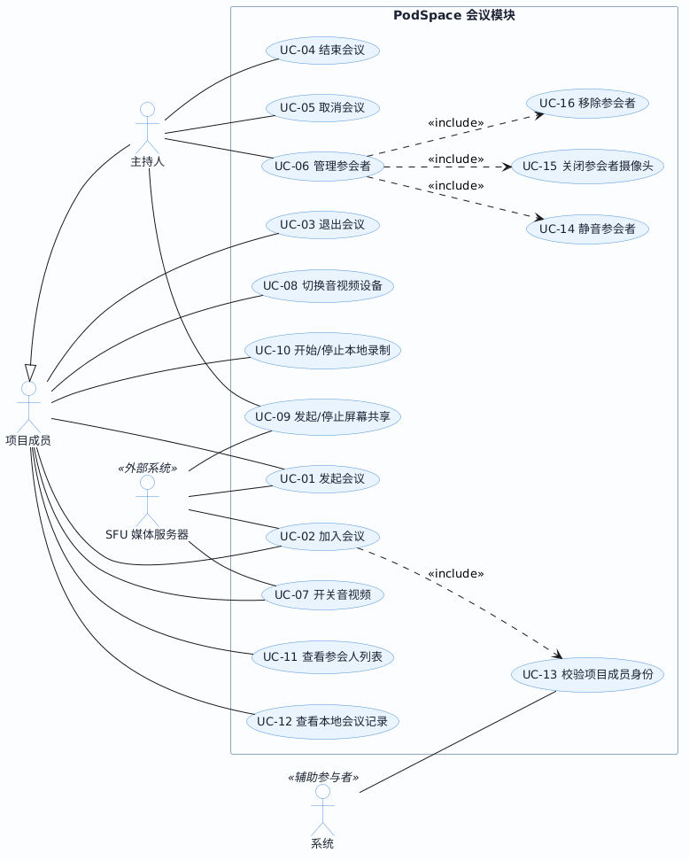

# 会议模块用况描述

> 本文档描述 PodSpace 会议模块的用况（Use Case），作为绘制用况图、编写用况模型的基础材料。
> 需求编号对应用户需求规格说明书 3\.1\.2 中的 MEETING-001 ~ MEETING-014。

---

## 1. 范围与系统边界

- **系统边界**：PodSpace 客户端中的「会议模块」，包含发起、加入、退出、结束、取消会议，以及会中的音视频、屏幕共享、录制、参会人管理。
- **不在范围内**：会议预约与周期会议、会议纪要、会议号/邀请链接、跨项目会议、云端录制与分享。
- **外部系统**：SFU 媒体服务器，负责媒体转发与房间管理。

---

## 2. 参与者

| 参与者 | 类型 | 说明 |
|---|---|---|
| 项目成员 | 主要参与者 | 属于会议所属项目的成员，可发起会议、加入会议、退出会议、开关音视频、录制、查看列表与记录 |
| 主持人 | 主要参与者（项目成员的角色） | 会议发起人，额外拥有管理参会者、共享屏幕、结束会议、取消会议的权限 |
| SFU 媒体服务器 | 外部系统 | 为会议创建房间、建立传输通道、转发音视频流 |
| 系统 | 辅助参与者 | 执行无需人工触发的自动行为，如拒绝非成员加入、默认名生成 |

> 说明：主持人是项目成员在会议中的角色，用况图中用泛化关系表示「主持人 → 项目成员」。

---

## 3. 用况清单

| 编号 | 用况名称 | 主要参与者 | 目标 | 关系 |
|---|---|---|---|---|
| UC-01 | 发起会议 | 项目成员 | 在项目内创建并开始一场即时会议 | — |
| UC-02 | 加入会议 | 项目成员 | 进入进行中的会议 | include UC-13 |
| UC-03 | 退出会议 | 项目成员 | 以普通参会者身份离开会议 | — |
| UC-04 | 结束会议 | 主持人 | 正常收尾并解散会议 | — |
| UC-05 | 取消会议 | 主持人 | 在会议进行中主动终止会议 | 独立用况 |
| UC-06 | 管理参会者 | 主持人 | 对指定成员静音、关闭摄像头或移出 | include UC-14、UC-15、UC-16 |
| UC-07 | 开关音视频 | 项目成员 | 控制自己的麦克风与摄像头 | — |
| UC-08 | 切换音视频设备 | 项目成员 | 更换麦克风或摄像头 | — |
| UC-09 | 发起/停止屏幕共享 | 主持人 | 将画面源切换为共享屏幕 | — |
| UC-10 | 开始/停止本地录制 | 项目成员 | 把会议内容录到本机 | — |
| UC-11 | 查看参会人列表 | 项目成员 | 了解当前在线成员与共享状态 | — |
| UC-12 | 查看本地会议记录 | 项目成员 | 回看本机历史会议记录 | — |
| UC-13 | 校验项目成员身份 | 项目成员 | 确认用户属于会议所属项目 | 被 UC-02 include |
| UC-14 | 静音参会者 | 主持人 | 关闭指定成员的麦克风 | 被 UC-06 include |
| UC-15 | 关闭参会者摄像头 | 主持人 | 关闭指定成员的摄像头 | 被 UC-06 include |
| UC-16 | 移除参会者 | 主持人 | 将指定成员移出会议 | 被 UC-06 include |

*图 1　会议模块用况图*

---

## 4. 用况描述

### UC-01 发起会议

| 项 | 内容 |
|---|---|
| 参与者 | 项目成员（发起后成为主持人） |
| 目标 | 在项目内创建一场即时会议并进入 |
| 前置条件 | 用户已登录且属于某个项目；该项目当前没有「进行中」的会议 |
| 触发 | 成员在项目内点击「发起会议」 |
| 主成功场景 | 1. 系统展示创建会议界面，可填写会议名（可留空）。 2. 成员确认发起。 3. 系统校验该项目无进行中会议，创建会议并置为「进行中」。 4. 系统将发起人设为主持人，生成会议入口。 5. 若会议名留空，系统生成默认名「会议-MM-dd HH:mm」。 6. 系统向 SFU 申请为该会议创建房间，返回房间就绪。 |
| 扩展场景 | 3a. 该项目已有进行中会议 → 提示「已有进行中的会议」，不创建。 6a. SFU 房间创建失败 → 会议置为失败并提示，不生成入口。 |
| 后置条件 | 会议状态为「进行中」，发起人为主持人，项目内其他成员可见会议入口 |
| 关联需求 | MEETING-001、MEETING-013；业务规则 2、5、11 |

### UC-02 加入会议

| 项 | 内容 |
|---|---|
| 参与者 | 项目成员；SFU 媒体服务器 |
| 目标 | 进入一场进行中的会议 |
| 前置条件 | 用户属于会议所属项目；会议处于「进行中」 |
| 触发 | 成员点击项目内的会议入口 |
| 主成功场景 | 1. 系统校验用户是否为项目成员（include UC-13）。 2. 校验会议状态为「进行中」、参会人数未达 10 人上限。 3. 系统向 SFU 申请为该成员建立传输通道，加入会议房间。 4. 成员进入会议，可看到参会人列表与画面。 5. 系统记录该成员的加入时间与角色（主持人/参会者）。 |
| 扩展场景 | 1a. 非项目成员 → 拒绝加入，提示无权限，不进入房间。 2a. 会议已结束/已取消 → 提示「会议已结束」，不进入。 2b. 参会人数已达 10 人 → 提示人数已满。 3a. SFU 建立传输失败 → 提示加入失败，可重试。 |
| 后置条件 | 成员在会议中，参会人列表更新 |
| 关联需求 | MEETING-002、MEETING-003；业务规则 6、8 |
| 关系 | include UC-13 校验项目成员身份 |

### UC-03 退出会议

| 项 | 内容 |
|---|---|
| 参与者 | 项目成员（普通参会者） |
| 目标 | 以普通参会者身份离开会议，不影响会议 |
| 前置条件 | 用户在会议中，且不是主持人 |
| 触发 | 参会者点击「退出会议」 |
| 主成功场景 | 1. 系统释放该成员与 SFU 的传输通道。 2. 从参会人列表移除该成员，记录退出时间。 3. 其他参会者不受影响。 |
| 扩展场景 | 1a. 释放通道失败 → 本地强制断开，列表仍更新，记录异常日志。 |
| 后置条件 | 该成员离开会议，会议继续 |
| 关联需求 | MEETING-005；业务规则 7 |

### UC-04 结束会议

| 项 | 内容 |
|---|---|
| 参与者 | 主持人 |
| 目标 | 正常收尾，解散会议房间 |
| 前置条件 | 用户是会议主持人；会议处于「进行中」 |
| 触发 | 主持人点击「结束会议」 |
| 主成功场景 | 1. 系统将会议状态置为「已结束」。 2. 通知全体参会者退出，释放各自与 SFU 的传输通道。 3. 销毁 SFU 中该会议房间。 4. 项目内会议入口消失。 5. 系统在本机生成一条本地会议记录（结束状态「已结束」）。 |
| 扩展场景 | 2a. 部分参会者断开失败 → 服务端强制清理通道，确保房间解散。 3a. 房间销毁失败 → 记录异常，入口仍消失，避免残留可加入状态。 |
| 后置条件 | 会议「已结束」，全体退出，入口消失，本地记录生成 |
| 关联需求 | MEETING-006、MEETING-010、MEETING-011；业务规则 3、9 |

### UC-05 取消会议

| 项 | 内容 |
|---|---|
| 参与者 | 主持人（发起人） |
| 目标 | 在会议进行中主动终止会议 |
| 前置条件 | 用户是会议发起人；会议处于「进行中」 |
| 触发 | 发起人点击「取消会议」 |
| 主成功场景 | 1. 系统将会议状态置为「已取消」。 2. 通知全体参会者退出，释放传输通道，销毁房间。 3. 项目内会议入口消失。 4. 本机生成一条本地会议记录（结束状态「已取消」）。 |
| 扩展场景 | 与 UC-04 相同，清理失败时强制清理并记录异常。 |
| 后置条件 | 会议「已取消」，全体退出，本地记录生成 |
| 关联需求 | MEETING-012；业务规则 4、12 |

### UC-06 管理参会者

| 项 | 内容 |
|---|---|
| 参与者 | 主持人 |
| 目标 | 维持会议秩序，处理影响会议的成员 |
| 前置条件 | 用户是主持人；会议处于「进行中」 |
| 触发 | 主持人在参会人列表中打开某成员的操作菜单 |
| 主成功场景 | 1. 主持人选择目标参会者与操作类型（静音 / 关闭摄像头 / 移除）。 2. 系统校验操作者为主持人。 3. 按操作类型分别执行 UC-14 静音参会者、UC-15 关闭参会者摄像头或 UC-16 移除参会者。 4. 操作结果对其他参会者生效，其他成员不受影响。 |
| 扩展场景 | 2a. 操作者不是主持人 → 拒绝，提示无权限。 3a. 目标成员已退出 → 提示成员不在会议中。 |
| 后置条件 | 目标成员的音视频状态改变，或被移出会议 |
| 关联需求 | MEETING-004；业务规则 7 |
| 关系 | include UC-14、UC-15、UC-16 |

### UC-07 开关音视频

| 项 | 内容 |
|---|---|
| 参与者 | 项目成员；SFU 媒体服务器 |
| 目标 | 控制自己的麦克风与摄像头 |
| 前置条件 | 用户在会议中 |
| 触发 | 用户点击麦克风 / 摄像头开关 |
| 主成功场景 | 1. 用户独立开关麦克风或摄像头，二者可同时开启。 2. 系统向 SFU 启用或暂停对应的媒体流。 3. 其他参会者实时听到声音 / 看到画面，或听不到 / 看不到。 |
| 扩展场景 | 2a. 设备被占用或权限被拒 → 提示开启失败，保持原状态。 2b. SFU 操作失败 → 提示失败，回滚本地开关状态。 |
| 后置条件 | 该成员的音视频发布状态与开关一致 |
| 关联需求 | MEETING-007；相关约束（画面源） |

### UC-08 切换音视频设备

| 项 | 内容 |
|---|---|
| 参与者 | 项目成员 |
| 目标 | 在多设备环境下切换到可用的麦克风或摄像头 |
| 前置条件 | 用户在会议中，本机存在多个可用音视频设备 |
| 触发 | 用户选择其他麦克风 / 摄像头 |
| 主成功场景 | 1. 系统枚举本机可用设备。 2. 用户选择目标设备。 3. 系统停止原设备采集，启用新设备，向 SFU 替换对应媒体流。 4. 其他参会者无感知或短暂切换后恢复。 |
| 扩展场景 | 3a. 新设备打开失败 → 恢复原设备，提示切换失败。 |
| 后置条件 | 该成员使用新设备采集 |
| 关联需求 | MEETING-007 |

### UC-09 发起 / 停止屏幕共享

| 项 | 内容 |
|---|---|
| 参与者 | 主持人；SFU 媒体服务器 |
| 目标 | 把画面源从摄像头切换为共享屏幕，并在需要时切回 |
| 前置条件 | 用户是主持人；会议处于「进行中」 |
| 触发 | 主持人点击「开始共享」或「停止共享」 |
| 主成功场景 | 1. 主持人发起共享，选择共享画面源。 2. 系统采集屏幕画面，向 SFU 发布屏幕媒体流。 3. 系统将画面源从摄像头切换为共享屏幕，其他参会者看到共享内容。 4. 停止共享时，系统撤销屏幕媒体流，画面源切回摄像头。 |
| 扩展场景 | 1a. 非主持人发起 → 拒绝，提示仅主持人可共享。 2a. 屏幕采集权限被拒 → 提示开启失败。 2b. 同一时刻已有共享 → 拒绝，保证只有一路画面源。 |
| 后置条件 | 画面源为共享屏幕或摄像头，同一时刻仅一路 |
| 关联需求 | MEETING-008；相关约束（画面源） |

### UC-10 开始 / 停止本地录制

| 项 | 内容 |
|---|---|
| 参与者 | 项目成员（任一参会者） |
| 目标 | 把会议内容录制到本机，供事后回放 |
| 前置条件 | 用户在会议中 |
| 触发 | 用户点击「开始录制」或「停止录制」 |
| 主成功场景 | 1. 用户开始录制，系统在本机默认位置创建录制文件。 2. 系统从 SFU 拉取会议媒体流写入本地文件。 3. 用户停止录制，文件落盘，可在本机回放。 |
| 扩展场景 | 1a. 磁盘空间不足或路径不可写 → 提示失败，不开始录制。 2a. 拉流中断 → 停止录制并保留已写入部分，提示录制中断。 |
| 后置条件 | 本机生成可回放的录制文件；录制为个人行为，不影响其他参会者 |
| 关联需求 | MEETING-009；相关约束（本机保存、不分享） |

### UC-11 查看参会人列表

| 项 | 内容 |
|---|---|
| 参与者 | 项目成员 |
| 目标 | 了解当前在线成员、角色与共享状态 |
| 前置条件 | 用户在会议中 |
| 触发 | 用户打开参会人列表 |
| 主成功场景 | 1. 系统展示当前在线成员列表。 2. 标识每个成员的角色（主持人 / 参会者）。 3. 标识当前是否有人正在共享屏幕。 |
| 扩展场景 | 1a. 列表同步失败 → 展示最近一次缓存列表并提示刷新。 |
| 后置条件 | 用户看到当前参会人状态 |
| 关联需求 | MEETING-014 |

### UC-12 查看本地会议记录

| 项 | 内容 |
|---|---|
| 参与者 | 项目成员 |
| 目标 | 回看本机已结束或已取消的会议记录 |
| 前置条件 | 本机存在已结束或已取消的会议记录 |
| 触发 | 用户打开本地会议记录 |
| 主成功场景 | 1. 系统读取本机会议记录列表。 2. 展示每条记录的会议名、开始时间、结束时间、时长、参会人、结束状态（已结束 / 已取消）。 |
| 扩展场景 | 1a. 记录文件损坏 → 提示部分记录不可读，其余正常展示。 |
| 后置条件 | 用户看到本机历史会议记录 |
| 关联需求 | MEETING-010；业务规则 12 |

### UC-13 校验项目成员身份

| 项 | 内容 |
|---|---|
| 参与者 | 项目成员；系统 |
| 目标 | 确认尝试加入会议的用户属于会议所属项目 |
| 前置条件 | 用户已登录；目标会议存在且处于「进行中」 |
| 触发 | 用户尝试加入会议，由 UC-02 调用 |
| 主成功场景 | 1. 系统读取目标会议所属项目。 2. 系统比对当前用户是否为该项目成员。 3. 校验通过，返回允许加入的结果。 |
| 扩展场景 | 2a. 当前用户不是项目成员 → 返回拒绝结果，提示无权限，加入流程终止。 2b. 目标会议已结束或已取消 → 返回拒绝结果，提示会议已结束。 |
| 后置条件 | 返回允许或拒绝的校验结果，不改变会议状态 |
| 关联需求 | MEETING-003；业务规则 8 |
| 关系 | 被 UC-02 include |

### UC-14 静音参会者

| 项 | 内容 |
|---|---|
| 参与者 | 主持人；目标参会者 |
| 目标 | 由主持人关闭指定成员的麦克风 |
| 前置条件 | 操作者是主持人；目标成员在会议中 |
| 触发 | 主持人在参会人列表中选择目标成员并点击「静音」 |
| 主成功场景 | 1. 主持人选择目标成员与「静音」操作。 2. 系统校验操作者为主持人。 3. 系统将目标成员的音频置为暂停，其他成员听不到其声音。 4. 目标成员界面显示「已被主持人静音」。 |
| 扩展场景 | 2a. 操作者不是主持人 → 拒绝，提示无权限。 3a. 目标成员已退出 → 提示成员不在会议中。 3b. 目标成员本已静音 → 保持静音，不重复提示。 |
| 后置条件 | 目标成员麦克风关闭，其他参会者听不到其声音 |
| 关联需求 | MEETING-004；业务规则 7 |
| 关系 | 被 UC-06 include |

### UC-15 关闭参会者摄像头

| 项 | 内容 |
|---|---|
| 参与者 | 主持人；目标参会者 |
| 目标 | 由主持人关闭指定成员的摄像头 |
| 前置条件 | 操作者是主持人；目标成员在会议中 |
| 触发 | 主持人在参会人列表中选择目标成员并点击「关闭摄像头」 |
| 主成功场景 | 1. 主持人选择目标成员与「关闭摄像头」操作。 2. 系统校验操作者为主持人。 3. 系统将目标成员的视频置为暂停，其他成员看不到其画面。 4. 目标成员画面变为头像占位，并标注「已被主持人关闭摄像头」。 |
| 扩展场景 | 2a. 操作者不是主持人 → 拒绝，提示无权限。 3a. 目标成员已退出 → 提示成员不在会议中。 3b. 目标成员摄像头本已关闭 → 保持关闭，不重复提示。 |
| 后置条件 | 目标成员摄像头关闭，其他参会者看不到其画面 |
| 关联需求 | MEETING-004；业务规则 7 |
| 关系 | 被 UC-06 include |

### UC-16 移除参会者

| 项 | 内容 |
|---|---|
| 参与者 | 主持人；目标参会者 |
| 目标 | 由主持人将指定成员移出会议 |
| 前置条件 | 操作者是主持人；目标成员在会议中 |
| 触发 | 主持人在参会人列表中选择目标成员并点击「移除」 |
| 主成功场景 | 1. 主持人选择目标成员与「移除」操作。 2. 系统校验操作者为主持人。 3. 系统释放目标成员与 SFU 的传输通道。 4. 系统将目标成员从参会人列表移除。 5. 目标成员被移出会议并收到提示。 |
| 扩展场景 | 2a. 操作者不是主持人 → 拒绝，提示无权限。 3a. 通道释放失败 → 强制断开并更新列表。 3b. 目标成员已退出 → 提示成员不在会议中。 |
| 后置条件 | 目标成员离开会议，参会人列表更新 |
| 关联需求 | MEETING-004；业务规则 7 |
| 关系 | 被 UC-06 include |

---

## 5. 系统自动行为（不单独建模为用况）

| 行为 | 触发条件 | 结果 | 关联需求 |
|---|---|---|---|
| 拒绝非成员加入 | 非项目成员尝试加入会议 | 拒绝，不进入房间 | MEETING-003；业务规则 8 |
| 主持人断线自动结束 | 主持人主动退出或断线 | 会议变「已结束」，全体退出 | MEETING-006；业务规则 3 |
| 默认会议名生成 | 创建会议时会议名留空 | 生成「会议-MM-dd HH:mm」 | MEETING-013；业务规则 11 |
| 会议结束入口消失 | 会议进入「已结束」或「已取消」 | 项目内会议入口消失，再进入提示已结束 | MEETING-011；业务规则 9 |

---

## 6. 用况关系汇总

| 关系类型 | 源 | 目标 | 说明 |
|---|---|---|---|
| 泛化 | 主持人 | 项目成员 | 主持人具备项目成员的全部用况，并额外拥有 UC-04、UC-05、UC-06、UC-09 |
| include | UC-02 加入会议 | UC-13 校验项目成员身份 | 加入会议前必须完成成员身份校验 |
| include | UC-06 管理参会者 | UC-14 静音参会者 | 静音是管理参会者的一种操作 |
| include | UC-06 管理参会者 | UC-15 关闭参会者摄像头 | 关闭摄像头是管理参会者的一种操作 |
| include | UC-06 管理参会者 | UC-16 移除参会者 | 移除是管理参会者的一种操作 |
| 独立 | UC-05 取消会议 | — | 与 UC-04 结束会议并列，结果相同但状态不同 |

---

## 7. 用况与需求追溯

### 7.1 用况覆盖的需求

| 用况 | 用况名称 | 覆盖需求 |
|---|---|---|
| UC-01 | 发起会议 | MEETING-001、MEETING-013 |
| UC-02 | 加入会议 | MEETING-002、MEETING-003 |
| UC-03 | 退出会议 | MEETING-005 |
| UC-04 | 结束会议 | MEETING-006、MEETING-010、MEETING-011 |
| UC-05 | 取消会议 | MEETING-012 |
| UC-06 | 管理参会者 | MEETING-004 |
| UC-07 | 开关音视频 | MEETING-007 |
| UC-08 | 切换音视频设备 | MEETING-007 |
| UC-09 | 发起/停止屏幕共享 | MEETING-008 |
| UC-10 | 开始/停止本地录制 | MEETING-009 |
| UC-11 | 查看参会人列表 | MEETING-014 |
| UC-12 | 查看本地会议记录 | MEETING-010 |
| UC-13 | 校验项目成员身份 | MEETING-003 |
| UC-14 | 静音参会者 | MEETING-004 |
| UC-15 | 关闭参会者摄像头 | MEETING-004 |
| UC-16 | 移除参会者 | MEETING-004 |

### 7.2 需求覆盖核对

| 需求编号 | 覆盖用况 |
|---|---|
| MEETING-001 | UC-01 |
| MEETING-002 | UC-02 |
| MEETING-003 | UC-02、UC-13 |
| MEETING-004 | UC-06、UC-14、UC-15、UC-16 |
| MEETING-005 | UC-03 |
| MEETING-006 | UC-04 |
| MEETING-007 | UC-07、UC-08 |
| MEETING-008 | UC-09 |
| MEETING-009 | UC-10 |
| MEETING-010 | UC-04、UC-12 |
| MEETING-011 | UC-04、UC-05 |
| MEETING-012 | UC-05 |
| MEETING-013 | UC-01 |
| MEETING-014 | UC-11 |
