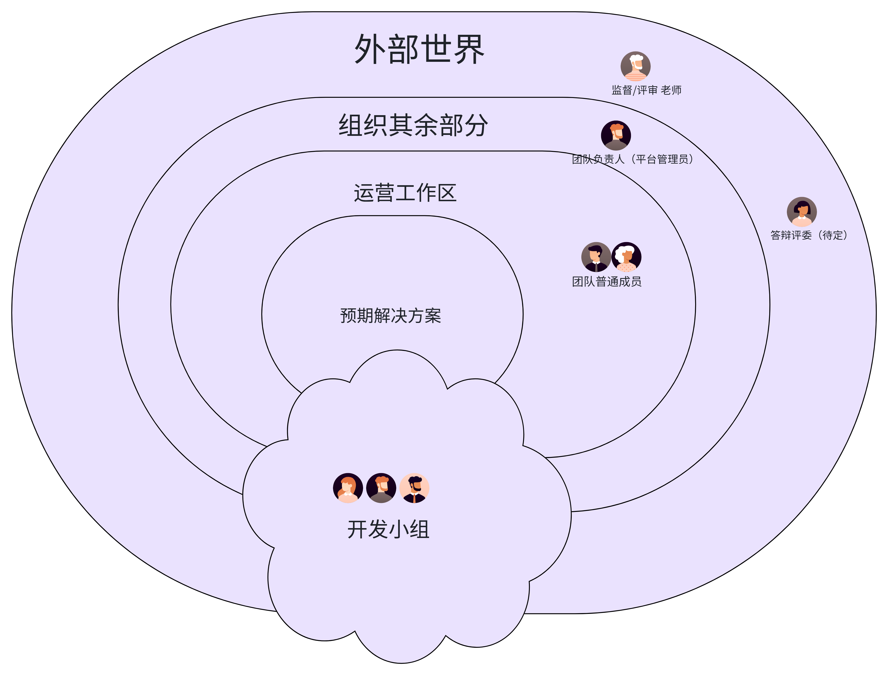
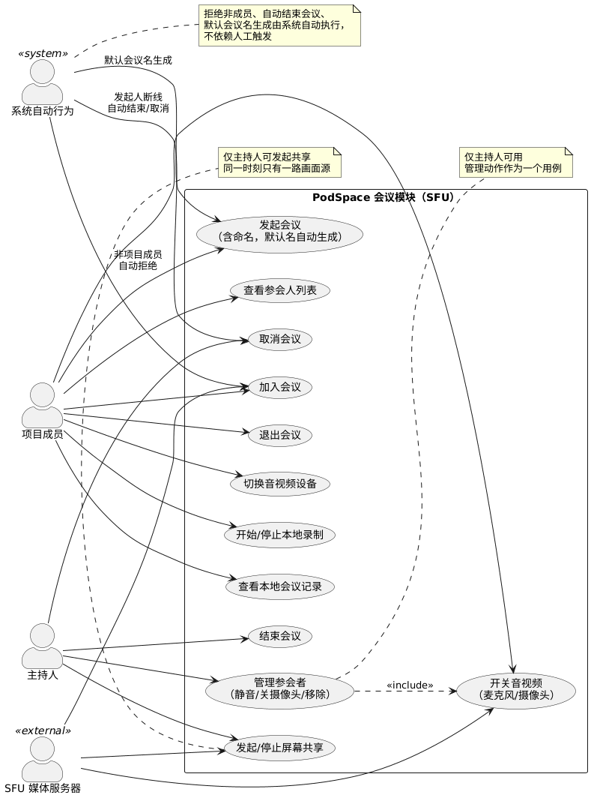
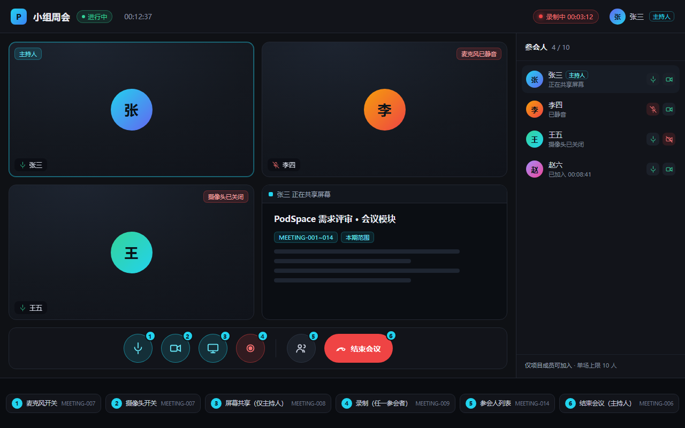
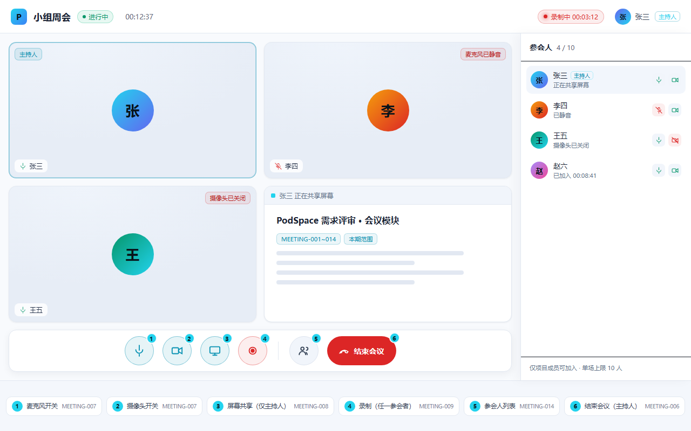

# 需求规格说明书（Software Requirements Specification）

---

- 项目名称：PodSpace

- 开发单位：三脚BUG队

- 文档版本：1\.1

- 编写日期：2026年10月31日

- 文档标准：GB/T 9385\-2008 《计算机软件需求规格说明规范》

---

# 一、引言

## 1\.1 编写目的

本文档旨在明确需求，明确功能和性能，方便用户和开发人员查看，达成共识，为之后的进一步开发软件打下基础。

## 1\.2 背景

随着互联网的发展，越来越多的软件接踵而至，其中不乏信息交流的软件，并且很多都是围绕协作打造，可是真正适合小型团队开发的协作软件是少之又少。 

对于一些小团队的人，一些基本的功能其实就够用了，而这个平台就提供了最基本的功能，聊天，文件传输，以及文档书写。

## 1\.3 预期读者

|预期读者|阅读建议|
|---|---|
|项目经理|希望通过这个文档，能基本了解产品预期功能，和用户需求，进而对项目进行系统的设计和管理。|
|开发人员|阅读完成之后能大概了解用户需求，并且据此设计前后端架构，完成预期功能，书写用户手册|
|测试人员|希望阅读之后，能书写对应功能的测试用例|
|用户|希望阅读之后，能了解项目预期功能，并且和开发人员协商需求的改动。|

## 1\.4 定义、缩写和术语

|术语|定义|
|---|---|
|US\-00X<br>|US是user story的缩写，也就是用户故事，00X，其中X是数字，这个表示的是序号。|
|MEETING\-00X|会议功能的需求编号，MEETING\-001 为第一条。|

## 1\.5 参考资料

施工中\.\.\.

---

# 二、项目总体描述

## 2\.1 产品概述

### 2\.1\.1 项目领域 Domain

本项目所属领域为团队协同办公领域，面向小型工作团队开发一款轻量化项目协作平台，支持任务管理、文件共享\(文档同时共同编辑\)、组内沟通、线上会议等功能。

### 2\.1\.2 项目目标 Goals（目的\-益处\-衡量指标）

1. 实现一套轻量化的线上协作平台，支持小团队成员进行任务分配、进度查看、文件上传；

2. 简化小团队项目管理流程，降低团队内部消息同步、资料流转的成本。

目标陈述

1\.目的

使10人以内的小团队，在不稳定的网络条件下，用一个轻量工具完成一次完整的协作周期（分工、沟通、传文件、共同写文档），并把这一周期的全部过程资料留在同一个项目空间内\.

2\.益处

（1）减少工具切换。四类信息收敛在一个项目空间内，成员不必在聊天群、网盘与文档工具之间来回搬运，项目结束后也不需要重新拼装资料。

（2）降低学习成本。界面只围绕五件事组织，新成员无需培训即可使用，团队不必为工具本身付出额外时间。

（3）内容不因网络抖动而丢失。本地缓存与自动同步使成员在校园网不稳定时仍敢继续编辑，减少重复劳动。

（4）**进度可判断**。负责人随时能看到任务在谁手上、到哪一步，减少反复询问与催办，这是小团队最容易发生的内耗。

3\.衡量指标

本系统需要满足：小组仅依靠本平台即可完成小组作业协同，无需搭配其他协作工具；新用户独立完成新建项目、添加任务、上传文件、编辑文档的整套流程耗时不超过 5 分钟；网络波动时能够本地缓存编辑内容，网络恢复后自动同步，保障用户输入不丢失；项目资源相互隔离，非项目成员无法访问本组任务、聊天、文件和文档；系统基础功能稳定，不会因消息推送、文档协同产生崩溃；音视频会议与屏幕共享在局域网环境下稳定运行、不崩溃。

价值陈述

（1）功能价值陈述（解决业务效率问题）

> 功能价值：解决方案使业务过程成本更低、速度更快、可以完成之前难以开展的工作。
> 
> 

1. 作为课程小组组员，当我可以在同一个项目空间查看分配给自己的任务、接收小组消息、提交作业文件、参与多人文档编写，不用在多个软件来回切换，我就获得了价值。

2. 作为学生项目组长，当我可以快速拆分分配任务、查看全部成员任务进度，集中查阅所有项目资料，减少反复口头沟通确认的工作量，我就获得了价值。

（2）心理价值陈述（体验、感受层面的价值）

> 心理价值：带来便利、新颖、降低焦虑、操作简单好上手。
> 
> 

1. 作为课程小组组员，当工具操作简单，不需要学习大量无关功能；并且在校园网络不稳定时，我的编辑内容不会丢失，不用反复重新录入内容，我就获得了价值。

2. 作为学生项目组长，当项目全部任务、聊天记录、文件、文档统一归档保存，项目结束之后可以随时回看历史资料，不用担心资料分散丢失，我就获得了价值。

（3）附加价值陈述

> 附加价值： 解决方案在核心用途之外，让用户额外获得可积累的协作资产或正向完成感。
> 
> 

1. 作为课程小组组员，当项目结束后，我在项目空间里提交过的文件、参与过的文档编辑、完成的任务记录都自动留存，我可以随时回看自己在这个项目里做了什么、改过哪些内容，不用自己另外整理，我就获得了价值。

2. 作为学生项目组长，当项目结束后，系统自动保留完整的任务分工、文件版本和讨论记录，我可以在下一个课程项目中直接参考上次的分工方式和资料结构，不用从零开始规划，我就获得了价值。

### 2\.1\.3 问题空间调查范围

本次调查的**问题空间**，是小团队从**组建**到**归档**的**一次完整协作周期**，具体包括以下七段工作：

1. 组队与进入：负责人建立项目、成员通过邀请加入项目、确定各自在项目中的角色；

2. 任务分工与跟踪：负责人把工作拆成任务、指定负责人与截止时间，成员更新任务状态，负责人查看整体进度；

3. 组内沟通：成员围绕任务、资料与进度交换文字信息，并在消息中顺带传递文件；

4. 资料流转：上传作业与方案文件、下载查看、在项目空间内保留文件归属与时间；

5. 共同撰写：多人围绕同一份报告或策划文档同时编辑，编辑结果对其他成员可见；

6. 项目归档：项目结束后，任务、文件与文档仍保留在项目空间内，可以回看与复用。

7. 线上会议：项目成员在项目空间内随时发起音视频会议，按需共享屏幕、录制会议，并在本地留存会议记录。

### 2\.1\.4 范围边界

边界之内的工作必须研究与实现，边界之外的内容本期明确不做，以避免课程项目范围失控。

|**范围内**|**范围外**|
|---|---|
|10人以内小团队的项目组建立、邀请与成员管理|大型组织部门架构、多级审批、考勤与工时统计|
|任务的建立、指派、状态变更与进度查看|甘特图、关键路径、成本核算与资源负载分析|
|项目组内文字消息、会话历史与消息附带文件|消息已读回执与@提醒|
|项目组内线上会议（音视频、屏幕共享、会议录制）|会议预约与周期会议、会议纪要、会议号/链接、跨项目会议|
|20MB以内文件的上传、列表、下载与删除|大文件断点续传、云盘配额、对外分享链接与提取码|
|多人同时编辑的纯文本文档与简易版本回溯|富文本排版、表格公式、Office格式导入导出|
|项目内数据隔离与管理员、成员两级权限|跨组织单点登录、第三方账号体系与组织通讯录|
|PC端客户端（Windows、Linux）|移动端应用、小程序、浏览器网页版|


### 2\.1\.5 项目涉众 Stakeholders

涉众是需求的来源。判断标准是：凡是能够影响PodSpace的决策与实现，或者会被PodSpace的运行结果影响的个人与组织，均列入涉众，而不只局限于直接操作软件的人。

1. 团队普通成员：平台终端使用者，需要接受任务、上传资料、查看项目进度、参与沟通，是核心需求来源；

2. 团队负责人（平台管理员）：统筹项目、分配权限、管理项目组，可对平台功能提出管理侧需求；

3. 开发团队：项目实施团队、负责需求落地、系统开发、测试与文档；

4. 课程指导教师、答辩评委（待定）：项目评审决策者，决定项目验收标准。



由于我们（团队）其实本身也是一个团队，所以这个洋葱图对我们同样适用。

## 2\.2 需求工程分析

### 2\.2\.1 三个世界（组织世界、技术世界、物理世界）

现实世界

├── 组织世界

│   ├── 小型团队成员（如：课程小组成员、项目组长）

│   ├── 指导教师/课程评委

│   ├── 团队内部的分工、角色与职责

│   ├── 小组协作的规章制度/沟通习惯

│   └── 课程项目的交付要求与验收标准

│

├── 技术世界

│   ├── 待开发的 PodSpace 系统（前后端）

│   ├── 现有的操作系统（Windows 11、Linux）

│   ├── 数据库技术（用于持久化数据）

│   └── 校园网/局域网

│

└── 物理世界

├── 用户的终端设备（Windows/Linux 电脑）

├── 服务器及网络通信设备（路由器、交换机等）

├── 用户输入/输出外设（键盘、鼠标、屏幕、麦克风）

└── 物理时钟与时间流逝（影响任务截止时间、弱网同步）

问题世界
├── 组织方面
│   └── 小组分工与角色职责、协作沟通习惯与规范、课程交付与验收要求、成员使用约定
├── 技术方面
│   └── 操作系统、数据库、局域网与服务端运行环境、外设驱动等待交互的现成软件组件
└── 物理方面
    └── 用户终端电脑、服务器与网络设备、麦克风

### 2\.2\.2 三个系统

1\.现状系统（system\-as\-is）：大学生小组可选用飞书、语雀等成熟协作工具，也常使用 QQ、微信开展沟通；但这类工具功能繁杂、体量较重，对于小型开发小组来说冗余功能多，上手成本高，同时存在免费版空间、权限等限制，并不适配轻量化小组协作场景。

2\.待建系统（system\-to\-be）：为本项目本次交付的目标系统，仅在局域网环境部署运行；面向大学生小型开发小组，提供基础即时聊天、文件传输、在线文档编写能力，打造精简无冗余的协作平台，适配小团队简单协作需求。

3\.后续待建系统（system\-to\-be\-next）：属于后续迭代规划内容，不在本次开发、验收范围之内，也许会在基础上扩展视频通话等一些功能。

### 2\.2\.3 需求工程三维度模型（WHY\-WHAT\-WHO）

研究问题世界需要回答三个维度的问题：为什么需要新系统（WHY）、系统要提供什么（WHAT）、责任由谁承担（WHO）。三者相互影响，呈螺旋关系。


1\.WHY

WHY 维度用于明确待建系统需要达成的目标，目标来源于现状系统存在的问题、可利用机会以及领域知识，由待建系统负责满足。 现状中飞书、语雀可互通，能够实现基础协作，但它面向企业设计、功能繁多，对课程小项目来说冗余度高，且不支持自定义裁剪。本项目并不追求超越商用工具的规模与能力，而是以软件工程课程实践为目的，打造轻量化的 PodSpace：整合聊天、文件传输、在线文档基础能力，操作简单；局域网本地存储项目资料，方便小组统一归档管理，支撑课程小组开发实践。

2\.WHAT

WHAT 维度定义系统需要提供的服务、高层业务约束与运行假设。 

系统服务：提供小组即时聊天、文件传输、在线文档编辑、组内音视频会议、任务管理核心协作服务。 高层约束：定位为课程实践轻量化协作平台，仅实现划定的核心服务；运行场景限定于局域网，面向 10 人以内课程小组。详细设计、性能、接口约束在文档后续章节细化。 假设：局域网通信正常；小组人员负责服务端启停维护；使用者规范上传资料。

3\.WHO

WHO 维度将 WHAT 中的服务、约束、假设分配给不同主体：

- Software\-to\-be（待开发软件 PodSpace）：实现聊天、文档、会议、任务、文件管理、权限校验等核心业务逻辑；

- People（人员）：项目组长管理成员，运维人员负责服务端启停维护，使用者遵守使用规范；

- Devices（硬件设备）：用户电脑、摄像头、麦克风、服务器、局域网网络设备；

- Existing software（已有软件）：操作系统、数据库。 人员、设备、已有软件共同构成系统运行环境。

### 2\.2\.4 现象（phenomena）与陈述（Statement）

**一、三类现象**

曾将现象划分为：世界现象；机器现象；如果我们进一步把注意力集中在所要构建机器中的软件部分，就会得到一种类似的划分。一个现象（phenomenon）可能归属于待开发软件，也可能归属于它的环境，或者由二者共享。环境还包括机器的输入/输出设备。

1. **环境现象**：存在于软件外部现实环境中的事实、状态与事件，独立于待开发软件，软件无法直接观测和控制。

2. **共享现象**：位于软件与外部环境的交互边界，环境和软件双方均可感知，是软件和外部世界交互的媒介。

3. **软件现象**：仅发生在待开发软件内部的计算、状态变化，外部环境无法直接观察。例如：某个错误变量在特定条件下取某个特定值这一现象，则归属于软件。

**二、陈述**

需求工程过程中涉及的关于待建系统的各种陈述，其范围可能不同。考虑到这些陈述在语气和范围上的差异，现在我们可以更加精确地定义需求工程过程中涉及的各种陈述类型。如下所示：

1\.需求

需求分为系统需求和软件需求。

A\.*系统需求（system requirement）*是一种规定性陈述，它由待开发软件来保证实现，必要时可与其他系统组件协同完成，并以环境现象来表述。

（1）团队成员在团队内应当能够开展沟通交流、文档协作、任务管理与文件共享。

（2）团队组长应当能够管理本团队成员，分配并管控团队任务。

（3）用户仅可访问自身权限范围内的文档、任务、文件等团队资源。

（4）团队产生的聊天记录、文档内容、任务信息、文件数据应当妥善留存，可供有权限的成员查阅。

（5）团队成员在权限允许的前提下，应当能够查看其他成员共享的文档与文件。

B\.*软件需求（software requirement）*是一种规定性陈述：它必须完全由待开发软件来保证，而且只能使用软件与环境之间的共享现象来表述。

（1）当用户提交聊天消息发送请求时，软件必须将该消息展示给指定接收方，并持久化展示该消息记录。

（2）当用户提交文档访问请求时，软件必须依据用户权限判定结果，向用户展示文档内容或者权限不足提示。

（3）当用户提交任务新增、修改请求时，软件必须更新任务信息，并向有权限查看该任务的用户展示更新后的任务状态。

（4）当用户提交文件上传请求时，软件必须反馈上传结果；当用户提交文件下载请求时，软件必须向用户提供对应文件。

（5）当用户发起任意资源访问请求时，软件必须执行权限校验，拒绝越权访问并向用户返回拒绝提示。

> 注意：按照定义，软件需求一定也是系统需求，但是反过来并不成立。
> 
> 

为更精确地刻画系统需求与软件需求之间的联系，引入四变量模型：

- 监测变量（monitored variables）是环境中的量，软件通过键盘等输入设备对这些量进行监测。

- 受控变量（controlled variables）是环境中的量，软件通过显示器等输出设备对这些量进行控制。

- 输入变量（input variables）是软件作为输入所需要的数据项。

- 输出变量（output variables）是软件作为输出所产生的量。

- 一个系统需求 *SysReq*，是监测变量集合 M与相应的受控变量集合C之间的一个关系：

SysReq   M × C

- 一个软件需求 SofReq，是输入变量集合I与相应的输出变量集合O之间的一个关系：

SofReq ⸦ I × O


2\.领域属性

*领域属性（domain property）*是关于问题世界的一种描述性陈述。无论系统如何运行——甚至无论是否存在待开发软件——领域属性都应当始终成立。领域属性通常对应于那些无法被违反的物理规律。

（1）一份任务不可能在同一时间既处于未完成状态，又处于已完成状态。

（2）一条聊天消息不可能同时属于两个不同的团队会话。

（3）一份文档不可能在同一时间对外呈现两套互相冲突的生效内容。

（4）一份文件不可能同时归属于两个相互独立的团队。

3\.假设

*假设（assumption）*是一种由环境来满足、并使用环境现象来表述的陈述。

（1）团队成员在编辑共享文档时，会留意其他成员同步更新的文档内容。

（2）团队成员会妥善保管自身账号凭证，不会随意共享账号。

（3）团队组长会合理分配团队内成员的协作任务。

（4）团队成员会主动查看团队内发布的消息与任务信息。

4\.定义

*定义（definitions）*是需求工程过程中涉及的最后一种陈述类型。定义使领域概念和辅助术语能够获得一种精确、完整并且各方一致认可的含义——也就是说，对所有人来说具有相同的含义。

（1）团队：在 PodSpace 中，一组为完成共同协作目标而聚集在一起的用户集合。

（2）团队组长：在一个团队内，拥有成员管理、任务管控权限的用户。

（3）团队成员：在一个团队内，可在权限范围内开展聊天、文档编辑、任务查看、文件操作的用户。

（4）共享文档：可供团队内多名有权限成员查看、编辑的文档资源。

（5）会话：用于承载团队成员之间聊天消息的交流空间。

（6）文档版本：共享文档在一次修改之后生成、可被回溯查看的文档快照。

## 2\.3 用户特征与场景

|用户画像|行为特征|使用环境（场景）|
|---|---|---|
|课程小组成员（20岁，大学生）<br>|时间碎片化，很多课程；接收开发/文档，上传作业才来哦，和队友同步问题，讨厌复杂冗余功能，优先看重简单好上手。|教室，使用卡得要死的校园网<br>宿舍，碎片化时间使用。|
|学生项目组长（21岁，大学生）|统筹小组课程项目，拆分任务，设置截止时间，需要快速汇材料和查看项目进度。|教室，使用卡得要死的校园网<br>宿舍，碎片化时间使用<br>路上，使用手机快速查看消息。|
|小型创业团队成员（25 岁）|项目节奏不稳定，经常临时调整任务；需要共享方案文档、同步客户反馈，随时沟通。|办公室 Wi‑Fi，<br>通勤路上 4G，电脑 \+ 手机随时切换。<br>|
|社团干事（19 岁，大学生）<br>|负责社团活动筹备，任务短期、一次性；需要分工、共享策划案、收集报名资料，活动结束后归档项目。|校园 Wi‑Fi，手机使用频次很高。|
|自由职业搭档（29 岁）|2\~3 人小搭档接单做设计 / 文案，收入项目制；需要区分不同接单项目，共享源文件，核对交付节点|居家 Wi‑Fi、移动网络，在家办公为主。|
|工作室小组长（26 岁）|管理 3–5 人小工作室，分配外包订单任务，核对交付进度，汇总交付文件。|工作室内网，电脑为主。|

客户优先级排序

1. **优先级 1（核心客户）：课程小组成员、学生项目组长**

理由：本项目原始业务出发点就是解决高校课程小组协作痛点；调研主要样本来源于该群体，弱网、轻量化、简单易用等核心需求全部来自这部分用户；全部 Must‑have 核心功能优先保障该群体使用体验。

2. **优先级 2（次要客户）：社团干事** 

    理由：业务场景和课程小组高度重合，现有系统能力可以直接兼容；但是项目多为短期一次性活动，持续使用频次低于课程小组，不为该群体新增专属功能。

3. **优先级 3（延伸兼容客户）：小型创业团队成员、自由职业搭档、工作室小组长** 

理由：属于兼容适配人群，现有功能可以满足他们基础协作需求；不属于本项目首要服务对象，不会为该类用户额外扩展业务功能。

## 2\.4 操作环境

客户端运行环境：windows11;Linux;

## 2\.5 设计与实现约束

### 2\.5\.1 指定的技术、工具与语言

#### 编程语言

|**约束**|**原因**|
|---|---|
|C\+\+语言编写后端|这个是评审人的硬性要求|
|C\+\+\(ASIO库\)作为网络|便携性高,跨平台|
|QML书写前端|学习成本更低，并且效果更好|

### 2\.5\.2 指定的运行环境

|**约束**|**原因**|
|---|---|
|Windows11强兼容|Windows11是十分流行的系统|

### 2\.5\.3 开发规范与标准

|**约束**|**原因**|
|---|---|
|Conventional Commit|这样可以让git提交记录更加的清晰易懂，节约时间。|
|fork仓库进行开发，提交使用pr|这样能更好保证仓库安全性，并且能分担冲突解决任务。|

### 2\.5\.4 外部系统接口约束

### 2\.5\.5 数据格式约束

任何数据格式都是OK的，txt，xml，json用来数据持久化都是可以的，并且如果前期使用json后期使用xml都是可行的。

## 2\.6 假设与依赖关系

\(1）假设:

a\.使用者配备 Windows11 或 Linux 电脑，具备安装客户端的权限； 

b\.服务端部署环境可用，服务器不会无预期关停； 

c\.用户能够遵守平台使用规范，不上传违规内容。 

（2）依赖:

a\.依赖后端服务提供数据交互、消息转发、文档协同同步能力； 

b\.依赖数据库完成项目、任务、文档、文件信息的持久化存储； 

c\.依赖客户端本地存储能力，实现弱网场景下内容缓存。

---

# 三、具体需求

## 3\.1 功能列表

|模块|功能|优先级|
|---|---|---|
|会议|发起/加入/结束会议、音视频通话、屏幕共享、会议录制、本地会议记录|必要|
|文档|创建、编辑、管理和共享文档|必要|
|聊天|即时消息、群组交流、消息管理、群内部文件管理|必要|
|任务|创建任务、分配负责人、跟踪任务进度|待定|

## 3\.2 功能需求

> **功能需求**和**部分非功能需求**是书写在同一个地方的，非功能需求类似一个卡片一样贴附在上边，这是借鉴了用户故事实践的思想
> 
> 

### 3\.2\.1 文档功能

**功能概述**

提供团队文档的创建、编辑、管理和共享能力，方便团队成员共同维护项目资料。

**功能需求**

|**编号**|**需求名称**|**需求描述**|**约束**|
|---|---|---|---|
|DOC\-001|创建文档|用户可以创建新的**团队（共享）**文档和**私密**文档。|创建时间 \< 0\.5s|
|DOC\-002|编辑文档|用户可以编辑已有文档的内容。|编辑文档能看到实时保存，并且能看到什么人正在查看。|
|DOC\-003|删除文档|用户可以删除自己有权限管理的文档。|无|
|DOC\-004|文档共享|用户可以将文档**共享**给团队内其他成员。|设置各种共享类型|
|DOC\-005|文档查看|用户可以查看**自己有权限访问**的文档。|无|

**相关约束**

- 文档内容需要支持 Markdown 格式。

这里的 Markdown 可以先作为待确认的产品约束，而不必现在就规定具体技术实现。

### 3\.2\.2 会议功能

**功能概述**

为项目成员提供项目组内的线上会议能力：成员可随时发起即时会议，其他项目成员在会议进行中随时加入，进行音视频通话与屏幕共享，并可将会议录制到本地、在本地留存会议记录。本期不做会议预约、周期会议与会议纪要，也不支持把会议号或链接分享给项目外成员。

**功能需求**

|编号|需求名称|需求描述|约束|
|---|---|---|---|
|MEETING\-001|发起即时会议|项目成员（含普通组员）在所属项目内发起会议，创建后立即进入「进行中」，发起人自动成为主持人。|无预约、无周期会议；同一项目同一时刻仅允许一个「进行中」会议|
|MEETING\-002|加入会议|项目成员在会议「进行中」时可随时加入，包括中途加入。|仅限本项目成员；单场参会人数上限为项目成员上限 10 人|
|MEETING\-003|拒绝非成员加入|非项目成员无法进入任何会议，既没有会议入口，直接访问也会被拒绝。|安全：越权加入必须被拒绝，且不得进入会议房间|
|MEETING\-004|主持人管理参会者|主持人可对任一参会者执行静音、关闭摄像头、移除操作。|仅主持人可用|
|MEETING\-005|参会者主动退出|普通参会者可主动退出会议；不能结束会议，也不能管理其他参会者。|无|
|MEETING\-006|结束会议|主持人结束会议时全体参会者退出；主持人主动退出或断线时，会议自动结束。|会议状态变为「已结束」|
|MEETING\-007|音视频控制|参会者可独立开关麦克风与摄像头，二者可同时开启，并可切换音视频设备。|无|
|MEETING\-008|屏幕共享|屏幕共享作为画面源的模式切换，切换后其他参会者看到共享的画面内容。|仅主持人可发起共享；同一时刻只有一路画面源|
|MEETING\-009|会议录制|任一参会者均可在会议进行中自行开始、停止录制，录制文件保存在本地，可回放。|录制为个人行为，各自保存于本机；不做云端存储与对外分享|
|MEETING\-010|本地会议记录|会议结束后在本机记录会议名、开始时间、结束时间、时长、参会人与结束状态。|仅本机可见；不做会议纪要；结束状态为「已结束」或「已取消」|
|MEETING\-011|入口消失与已结束提示|会议结束后项目内的会议入口消失；再次尝试进入时提示「会议已结束」。|无|
|MEETING\-012|取消会议|发起人可在会议「进行中」主动取消会议；取消后全体参会者退出，会议状态记为「已取消」。|仅发起人可取消；取消与结束都解散房间，仅状态不同|
|MEETING\-013|命名会议|发起人创建会议时可填写会议名称；未填写时系统自动生成默认名称「会议\-MM\-dd HH:mm」。该名称用于会议入口与本地会议记录。|会议名非必填；默认名按创建时间生成|
|MEETING\-014|查看参会人列表|参会者可查看当前在线成员列表，并识别当前是否有人正在共享屏幕。|仅本项目成员可见；会议结束后列表消失|

**业务规则**

1. 会议状态只有三种：进行中、已结束、已取消；不存在「待召开」状态。

2. 发起即开始，发起人自动成为主持人，无需审批。

3. 主持人主动退出或断线，会议立即结束，全体参会者一并退出。

4. 「结束」为正常收尾，「取消」为发起人在会议进行中主动终止；两者结果都是解散房间，仅记录的结束状态不同。

5. 同一项目同一时刻只允许存在一个「进行中」会议。

6. 单场会议参会人数上限与项目成员上限一致，为 10 人。

7. 普通参会者只能主动退出，无权结束会议、无权管理他人。

8. 非项目成员无法获得会议入口，直接访问同样被拒绝。

9. 会议结束后入口消失，再次进入提示「会议已结束」。

10. 同一成员同一时刻只允许一个会议连接（单设备）。

11. 会议名称可留空，留空时使用默认名「会议\-MM\-dd HH:mm」。

12. 取消会议同样生成一条本地会议记录，结束状态记为「已取消」。

**相关约束**

- 音视频与屏幕共享同属一个画面源：同一时刻只显示摄像头画面或共享屏幕其中之一，切换即改变画面源。

- 录制文件与会议记录均保存在本机，不随项目同步，也不提供对外分享能力。

### 3\.2\.3 聊天功能

**功能概述**

为团队组成员提供必要的沟通能力，支持会话历史留存与相关文件传递（例如图片或者文档）以及语音聊天交流。

**功能需求**

|**编号**|**需求名称**|**需求描述**|**约束**|
|---|---|---|---|
|CHAT\-001|发送文字消息<br>|成员可以在会话中发送文字消息，消息对其他成员可见|单条文本消息体 ≤ 150KB|
|CHAT\-002|发送图片消息|成员可发送图片，图片在会话中内嵌展示，支持点击查看大图。|支持jpg/png；单张\<=10MB|
|CHAT\-003|发送视频消息|成员可以发送视频文件，接收方可以下载之后播放|支持MP4；单个视频\<=100MB；不支持在线预览|
|CHAT\-004|发送文档消息|成员可以发送常见格式文档，接收方可以预览，也可以下载保存。|支持pdf/doc/docx/ppt/txt/zip/tar\.gz/xls;单个文件\<=50MB|
|CHAT\-005|接受查看会话历史|成员进入会话可以查看历史消息，可以通过选择时间查看历史消息|首次进入加载最近40条|
|CHAT\-006|接受消息|成员在线时可实时接收本项目新消息；不在线时消息留存，下次进入会话可见。|离线期间消息不丢失|
|CHAT\-007|文件下载|接收方可以下载消息中的文件，保存在本地之后可以随时查看不会丢失数据|下载的文件应该与发送方发送的文件一致|
|CHAT\-008|项目数据隔离|非同项目的成员不可以随便访问本组的相关聊天记录与文件|无|
|CHAT\-009|发送失败处理|聊天框中发送的数据没有发送成功时会给出明确提示，支持重发|重发不会产生重复消息|
|CHAT\-010|会话文件汇总|成员可以通过分类查看本项目会话中发送过的全部文件列表（图片/视频/文档分类），可以让成员快速方便地查找文件|相关分类陈列顺序按照时间倒序排列，可以先查找最近的文件|

**业务规则**

1. 会话类型：分为"项目会话"（组内公开，项目全体成员可见）与"私聊会话"（一对一）。

2. 权限：只有同一项目的会话成员可以进行上述活动，成员退出项目小组群之后就不再具备访问该项目下任何会话的权限。

**相关约束**

1. 文件大小具有相关限制，具体数据还可以进行调整。

2. 私聊内容只有彼此可见，即使是项目负责人，也不可以见，符合隐私约束。

### 3\.2\.4 任务功能

任务功能用于帮助用户管理个人待办事项和团队协作任务，支持任务的创建、查看、编辑、删除、分配及状态更新。

**功能需求：**

|**编号**|**需求名称**|**需求描述**|**约束**|
|---|---|---|---|
|TASK\-001|创建任务|**用户**可以创建个人任务或团队任务，并填写任务名称、描述等基本信息。|**任务名称**不能为空。|
|TASK\-002|查看任务|**用户**可以查看自己创建的**个人任务**，以及有权访问的**团队任务**。|**用户**只能查看自己有权访问的任务。|
|TASK\-003|编辑任务|**用户**可以**修改任务**的名称、描述、负责人、截止时间等信息。|**用户**必须拥有对应任务的**编辑权限**。|
|TASK\-004|删除任务|**用户**可以删除自己**有权限管理**的任务。|用户必须拥有对应任务的**删除权限**。|
|TASK\-005|分配任务|**团队成员**可以将**团队任务**分配给团队内的**其他成员**。|被分配者必须属于当前团队。|
|TASK\-006|更新任务状态|**用户**可以更新**任务状态**，包括待处理、进行中和已完成。|用户必须拥有对应任务的**操作权限**。|
|TASK\-007|查看任务进度|**用户**可以查看任务的**当前状态**及**完成情况**。|仅展示用户有权访问的**任务信息**。|

**业务规则：**

1. 任务分为**个人任务**和**团队任务**，两种任务具有**不同的可见范围**。

2. **个人任务**默认仅创建者本人可见和管理。

3. **团队任务**仅对具有相应访问权限的团队成员开放。

4. **团队任务**的负责人必须是该团队的成员。

5. **用户**只能对自己具有相应权限的任务进行操作。

**相关约束：**

1. **个人任务**与团队任务应具有独立的**归属关系**和**访问权限**。

2. **个人任务**仅允许创建者本人访问和管理。

3. **团队任务**仅允许所属团队中具有相应权限的成员访问和操作。

4. **团队任务**的负责人必须是所属团队的有效成员。

## 3\.3 性能需求

### 3\.3\.1 会议性能需求

|**编号**|**性能项**|**指标**|
|---|---|---|
|PERF\-001|会议并发|支持单场 10 人同时在线音视频|

> 说明：本期会议功能仅在局域网环境下测试与验收，不考核网络延迟、抖动与弱网可用性。
> 
> 

## 3\.4 外部接口需求

### 3\.4\.1 会议外部接口需求

会议功能需要以下外部能力支撑。本节只描述所需能力，不规定协议、库或实现方式。

|**编号**|**接口类别**|**需要的能力**|**关联需求**|
|---|---|---|---|
|EXT\-001|媒体采集|获取摄像头画面、麦克风声音与屏幕画面，支持随时开启与关闭|MEETING\-007、008|
|EXT\-002|本地存储|写入录制文件与本地会议记录；提供默认保存位置，并允许用户修改|MEETING\-009、010|
|EXT\-003|成员身份|校验当前用户是否属于会议所属项目|MEETING\-002、003|
|EXT\-004|会议入口|查询项目内是否存在进行中的会议及其状态|MEETING\-001、011、014|

**约束**：本期不与第三方会议系统对接，不提供会议号、邀请链接或对外分享方式。

## 3\.5 系统属性

### 3\.5\.1 会议系统属性

|**编号**|**属性**|**要求**|**关联需求**|
|---|---|---|---|
|SYS\-001|安全性|非项目成员无法加入会议；录制文件与会议记录仅保存在本机，不提供对外分享|MEETING\-003、009、010|
|SYS\-002|可靠性|主持人退出或断线时会议必须结束，所有参会者被移出，会议状态一致，不允许出现房间已解散但成员仍在|MEETING\-006|
|SYS\-003|可用性|会议进行中，项目内入口对全部项目成员可见；会议结束后入口消失并提示已结束|MEETING\-011|
|SYS\-004|可测试性|会议状态只有三种且转移明确，任一状态均可从界面观察|MEETING\-001、006、012|
|SYS\-005|兼容性|会议功能运行于 PC 客户端（Windows、Linux），与 2\.1\.4 范围边界一致|2\.1\.4|

## 3\.6 数据需求

### 3\.6\.1 会议数据需求

会议功能涉及四类数据。本节只描述数据实体与字段，不规定存储方式与文件格式。

#### 3\.6\.1\.1 会议

|**字段**|**说明**|
|---|---|
|会议名|创建时填写；留空时系统生成默认名「会议\-MM\-dd HH:mm」|
|状态|进行中 / 已结束 / 已取消|
|发起人|创建会议的项目成员，自动成为主持人|
|所属项目|会议所属的项目|
|开始时间|会议进入「进行中」的时间|
|结束时间|会议结束或取消的时间；进行中为空|

#### 3\.6\.1\.2 参会人

|**字段**|**说明**|
|---|---|
|成员|加入会议的项目成员|
|角色|主持人 / 参会者|
|加入时间|进入会议的时间|
|退出时间|离开会议或会议结束的时间|

#### 3\.6\.1\.3 录制文件

|**字段**|**说明**|
|---|---|
|所属会议|录制文件对应的会议|
|录制者|发起录制的参会者|
|生成时间|录制开始时间|
|文件位置|默认保存位置，用户可修改|

#### 3\.6\.1\.4 本地会议记录

|**字段**|**说明**|
|---|---|
|会议名|与会议名称一致，默认名同样适用|
|开始时间|会议进入进行中的时间|
|结束时间|会议结束或取消的时间|
|时长|结束时间与开始时间之差|
|参会人|本次会议的参会成员列表|
|结束状态|已结束 / 已取消|

**约束**：录制文件与本地会议记录仅保存在本机，不随项目同步。

## 3\.7 逻辑结构说明

### 3\.7\.1 会议逻辑结构说明

会议功能按下表划分职责。本节只描述模块职责边界，不涉及实现细节与代码结构。

|**模块**|**职责**|**不负责**|
|---|---|---|
|会议管理|创建、结束、取消会议，维护会议状态与会议名|媒体传输细节|
|参会人管理|加入、退出、移除参会者，维护参会人列表|成员身份体系本身|
|媒体会话|开启/关闭麦克风与摄像头、切换音视频设备、切换画面源|录制与会议记录|
|屏幕共享|主持人发起共享、退出共享|会议状态|
|会议录制|任一参会者开始/停止录制，保存到本机默认位置或用户指定位置|会议生命周期|
|本地记录|会议结束或取消后生成并保存本地会议记录|云端同步与分享|

# 四、用例模型与典型场景

## 4\.1 用例图

### 4\.1\.1 会议用例图



## 4\.2 主要用例描述

### 4\.2\.1 会议

#### UC\-01 发起会议

|项|内容|
|---|---|
|参与者|项目成员（发起后成为主持人）|
|前置条件|用户已登录且属于某个项目；该项目当前没有「进行中」的会议|
|触发|成员在项目内点击「发起会议」|
|基本流|1\. 系统展示创建会议界面，可填写会议名（可留空）。\<br\>2\. 成员确认发起。\<br\>3\. 系统校验该项目无进行中会议，创建会议并置为「进行中」。\<br\>4\. 系统将发起人设为主持人，生成会议入口。\<br\>5\. 若会议名留空，系统生成默认名「会议\-MM\-dd HH:mm」。\<br\>6\. 系统向 SFU 申请为该会议创建房间（Router），返回会议房间就绪。|
|异常流|3a\. 该项目已有进行中会议 → 提示「已有进行中的会议」，不创建。\<br\>6a\. SFU 房间创建失败 → 会议置为失败并提示，不生成入口。|
|后置条件|会议状态为「进行中」，发起人为主持人，项目内其他成员可见会议入口|
|关联需求|MEETING\-001、MEETING\-013；业务规则 2、5、11|

#### UC\-02 加入会议

|项|内容|
|---|---|
|参与者|项目成员；SFU 媒体服务器|
|前置条件|用户属于会议所属项目；会议处于「进行中」|
|触发|成员点击项目内的会议入口|
|基本流|1\. 系统校验用户是否为项目成员。\<br\>2\. 校验会议状态为「进行中」、参会人数未达 10 人上限。\<br\>3\. 系统向 SFU 申请为该成员建立传输通道，加入会议房间。\<br\>4\. 成员进入会议，可看到参会人列表与画面。\<br\>5\. 系统记录该成员的加入时间与角色（主持人/参会者）。|
|异常流|1a\. 非项目成员 → 拒绝加入，提示无权限，不进入房间（系统自动行为）。\<br\>2a\. 会议已结束/已取消 → 提示「会议已结束」，不进入。\<br\>2b\. 参会人数已达 10 人 → 提示人数已满。\<br\>3a\. SFU 建立传输失败 → 提示加入失败，可重试。|
|后置条件|成员在会议中，参会人列表更新|
|关联需求|MEETING\-002、MEETING\-003；业务规则 6、8|

#### UC\-03 退出会议

|项|内容|
|---|---|
|参与者|项目成员（普通参会者）|
|前置条件|用户在会议中，且不是主持人|
|触发|参会者点击「退出会议」|
|基本流|1\. 系统释放该成员与 SFU 的传输通道。\<br\>2\. 从参会人列表移除该成员，记录退出时间。\<br\>3\. 其他参会者不受影响。|
|异常流|1a\. 释放通道失败 → 本地强制断开，列表仍更新，记录异常日志。|
|后置条件|该成员离开会议，会议继续|
|关联需求|MEETING\-005；业务规则 7|

#### UC\-04 结束会议

|项|内容|
|---|---|
|参与者|主持人|
|前置条件|用户是会议主持人；会议处于「进行中」|
|触发|主持人点击「结束会议」|
|基本流|1\. 系统将会议状态置为「已结束」。\<br\>2\. 通知全体参会者退出，释放各自与 SFU 的传输通道。\<br\>3\. 销毁 SFU 中该会议房间。\<br\>4\. 项目内会议入口消失。\<br\>5\. 系统在本机生成一条本地会议记录（结束状态「已结束」）。|
|异常流|2a\. 部分参会者断开失败 → 服务端强制清理通道，确保房间解散。\<br\>3a\. 房间销毁失败 → 记录异常，入口仍消失，避免残留可加入状态。|
|后置条件|会议「已结束」，全体退出，入口消失，本地记录生成|
|关联需求|MEETING\-006、MEETING\-010、MEETING\-011；业务规则 3、9|

#### UC\-05 取消会议

|项|内容|
|---|---|
|参与者|主持人（发起人）|
|前置条件|用户是会议发起人；会议处于「进行中」|
|触发|发起人点击「取消会议」|
|基本流|1\. 系统将会议状态置为「已取消」。\<br\>2\. 通知全体参会者退出，释放传输通道，销毁房间。\<br\>3\. 项目内会议入口消失。\<br\>4\. 本机生成一条本地会议记录（结束状态「已取消」）。|
|异常流|与 UC\-04 相同，清理失败时强制清理并记录异常。|
|后置条件|会议「已取消」，全体退出，本地记录生成|
|关联需求|MEETING\-012；业务规则 4、12|

#### UC\-06 管理参会者（静音 / 关摄像头 / 移除）

|项|内容|
|---|---|
|参与者|主持人|
|前置条件|用户是主持人；目标参会者在会议中|
|触发|主持人在参会人列表中对某成员执行静音 / 关闭摄像头 / 移除|
|基本流|1\. 主持人选择目标参会者与操作类型。\<br\>2\. 系统校验操作者为主持人。\<br\>3\. 静音：系统将目标成员的音频 producer 置为暂停，其他成员听不到其声音。\<br\>4\. 关摄像头：系统将目标成员的视频 producer 置为暂停，其他成员看不到其画面。\<br\>5\. 移除：系统释放目标成员与 SFU 的传输通道，将其从参会人列表移除。\<br\>6\. 操作结果对其他参会者生效，其他成员不受影响。|
|异常流|2a\. 操作者不是主持人 → 拒绝，提示无权限。\<br\>3a/4a\. 目标成员已退出 → 提示成员不在会议中。\<br\>5a\. 移除时通道释放失败 → 强制断开并更新列表。|
|后置条件|目标成员的音视频状态改变，或被移出会议|
|关联需求|MEETING\-004；业务规则 7|

#### UC\-07 开关音视频

|项|内容|
|---|---|
|参与者|项目成员；SFU 媒体服务器|
|前置条件|用户在会议中|
|触发|用户点击麦克风 / 摄像头开关|
|基本流|1\. 用户独立开关麦克风或摄像头，二者可同时开启。\<br\>2\. 系统向 SFU 启用或暂停对应的 producer。\<br\>3\. 其他参会者实时听到声音 / 看到画面，或听不到 / 看不到。|
|异常流|2a\. 设备被占用或权限被拒 → 提示开启失败，保持原状态。\<br\>2b\. SFU 操作失败 → 提示失败，回滚本地开关状态。|
|后置条件|该成员的音视频发布状态与开关一致|
|关联需求|MEETING\-007；相关约束（画面源）|

#### UC\-08 切换音视频设备

|项|内容|
|---|---|
|参与者|项目成员|
|前置条件|用户在会议中，本机存在多个可用音视频设备|
|触发|用户选择其他麦克风 / 摄像头|
|基本流|1\. 系统枚举本机可用设备。\<br\>2\. 用户选择目标设备。\<br\>3\. 系统停止原设备采集，启用新设备，向 SFU 替换对应 producer。\<br\>4\. 其他参会者无感知或短暂切换后恢复。|
|异常流|3a\. 新设备打开失败 → 恢复原设备，提示切换失败。|
|后置条件|该成员使用新设备采集|
|关联需求|MEETING\-007|

#### UC\-09 发起 / 停止屏幕共享


|项|内容|
|---|---|
|参与者|主持人；SFU 媒体服务器|
|前置条件|用户是主持人；会议处于「进行中」|
|触发|主持人点击「开始共享」或「停止共享」|
|基本流|1\. 主持人发起共享，选择共享画面源。\<br\>2\. 系统采集屏幕画面，向 SFU 发布屏幕 producer。\<br\>3\. 系统将画面源从摄像头切换为共享屏幕，其他参会者看到共享内容。\<br\>4\. 停止共享时，系统撤销屏幕 producer，画面源切回摄像头。|
|异常流|1a\. 非主持人发起 → 拒绝，提示仅主持人可共享。\<br\>2a\. 屏幕采集权限被拒 → 提示开启失败。\<br\>2b\. 同一时刻已有共享 → 拒绝，保证只有一路画面源。|
|后置条件|画面源为共享屏幕或摄像头，同一时刻仅一路|
|关联需求|MEETING\-008；相关约束（画面源）|

#### UC\-10 开始 / 停止本地录制

|项|内容|
|---|---|
|参与者|项目成员（任一参会者）|
|前置条件|用户在会议中|
|触发|用户点击「开始录制」或「停止录制」|
|基本流|1\. 用户开始录制，系统在本机默认位置创建录制文件。\<br\>2\. 系统从 SFU 拉取会议媒体流写入本地文件。\<br\>3\. 用户停止录制，文件落盘，可在本机回放。|
|异常流|1a\. 磁盘空间不足或路径不可写 → 提示失败，不开始录制。\<br\>2a\. 拉流中断 → 停止录制并保留已写入部分，提示录制中断。|
|后置条件|本机生成可回放的录制文件；录制为个人行为，不影响其他参会者|
|关联需求|MEETING\-009；相关约束（本机保存、不分享）|

#### UC\-11 查看参会人列表

|项|内容|
|---|---|
|参与者|项目成员|
|前置条件|用户在会议中|
|触发|用户打开参会人列表|
|基本流|1\. 系统展示当前在线成员列表。\<br\>2\. 标识每个成员的角色（主持人 / 参会者）。\<br\>3\. 标识当前是否有人正在共享屏幕。|
|异常流|1a\. 列表同步失败 → 展示最近一次缓存列表并提示刷新。|
|后置条件|用户看到当前参会人状态|
|关联需求|MEETING\-014|

#### UC\-12 查看本地会议记录

|项|内容|
|---|---|
|参与者|项目成员|
|前置条件|本机存在已结束或已取消的会议记录|
|触发|用户打开本地会议记录|
|基本流|1\. 系统读取本机会议记录列表。\<br\>2\. 展示每条记录的会议名、开始时间、结束时间、时长、参会人、结束状态（已结束 / 已取消）。|
|异常流|1a\. 记录文件损坏 → 提示部分记录不可读，其余正常展示。|
|后置条件|用户看到本机历史会议记录|
|关联需求|MEETING\-010；业务规则 12|

## 4\.3 异常与扩展流程

### 4\.3\.1 会议

|行为|触发条件|结果|关联需求|
|---|---|---|---|
|拒绝非成员加入|非项目成员尝试加入会议|拒绝，不进入房间|MEETING\-003；业务规则 8|
|主持人断线自动结束|主持人主动退出或断线|会议变「已结束」，全体退出|MEETING\-006；业务规则 3|
|默认会议名生成|创建会议时会议名留空|生成「会议\-MM\-dd HH:mm」|MEETING\-013；业务规则 11|
|会议结束入口消失|会议进入「已结束」或「已取消」|项目内会议入口消失，再进入提示已结束|MEETING\-011；业务规则 9|

# 五、界面原型与交互设计

## 5\.1 页面原型图

### 5\.1\.1 会议主界面




图 5\-1　会议进行中主界面（深色主题）



图 5\-2　会议进行中主界面（浅色主题）

## 5\.2 页面流程

### 5\.2\.1 会议页面流程

会议功能包含三个页面状态：项目内会议入口、创建会议对话框、会议中主界面。

1. **项目详情页**：存在进行中会议时显示入口卡片（会议名、主持人、已参会人数）；不存在时仅显示「发起会议」按钮。

2. **发起会议**：点击「发起会议」弹出创建对话框，含会议名输入框（占位提示「留空将自动命名」）与「取消」「发起」两个按钮。

3. **创建成功**：直接进入会议中主界面，发起人标记为主持人。

4. **创建失败**：项目已有进行中会议时，对话框内提示「已有进行中的会议」，不创建。

5. **加入会议**：点击入口卡片，系统校验项目成员身份与会议状态后进入会议中主界面。

6. **会议中**：可开关音视频、共享屏幕、录制、查看参会人列表。

7. **结束会议**：主持人点击⑥并二次确认，全体退出并回到项目页，入口消失，本机生成一条记录。

8. **退出会议**：普通参会者退出，仅本人离开，会议继续。

9. **会议已结束或已取消**：再次点击入口提示「会议已结束」，不进入房间。

页面流转关系如下：

```Plain Text
项目页（无会议）── 发起会议 ──▶ 创建成功 ──▶ 会议中 ── 结束 ──▶ 项目页（入口消失）
项目页（有会议）── 加入会议 ──▶ 会议中 ── 退出 / 被结束 ──▶ 项目页
```

text

## 5\.3 交互逻辑说明

### 5\.3\.1 会议交互逻辑

**控制栏**

|**控件**|**交互**|**反馈**|**关联需求**|
|---|---|---|---|
|① 麦克风|单击切换开启与关闭|开启时青色高亮；关闭时图标变红划线，视频格出现「麦克风已静音」|MEETING\-007|
|② 摄像头|单击切换开启与关闭|关闭时视频格变为头像占位并标注「摄像头已关闭」|MEETING\-007|
|③ 屏幕共享|单击开始或停止共享|开始后视频区切换为共享画面；非主持人点击提示「仅主持人可共享」|MEETING\-008|
|④ 录制|单击开始或停止录制|录制中顶栏出现红点与时长，按钮红色高亮|MEETING\-009|
|⑤ 参会人|单击展开或收起右侧栏|有成员加入或退出时列表与人数实时更新|MEETING\-014|
|⑥ 结束会议|单击并二次确认|全体退出，回到项目页，入口消失|MEETING\-006|

**参会人栏**

- 成员加入或退出时，列表项与「已参会人数 / 10」实时变化；

- 每行显示角色标签（主持人）与当前状态（正在共享屏幕、已静音、摄像头已关闭、已加入时长）；

- 麦克风与摄像头图标与实际状态一致：开启为绿色，关闭为红色；

- 参会人数达到 10 人后，新的加入请求被拒绝并提示「人数已满」。

**视频区**

- 正在发言的成员画面加青色描边，作为当前发言提示；

- 关闭摄像头的成员显示头像占位，不显示黑屏；

- 屏幕共享时，共享画面替换该成员的摄像头画面，同一时刻只显示一路画面源；

- 停止共享后，画面自动切回摄像头。

**异常与反馈**

|**场景**|**反馈**|
|---|---|
|非项目成员尝试加入|拒绝进入并提示无权限（系统自动处理，不出现入口）|
|项目已有进行中会议时再次发起|提示「已有进行中的会议」，不创建|
|会议已结束或已取消后点击入口|提示「会议已结束」|
|主持人退出或断线|会议自动结束，全员被移出，界面回到项目页|

# 六、非功能需求

## 6\.1 安全与隐私保护

## 6\.2 兼容性与可移植性

## 6\.3 国际化/本地化

## 6\.4 数据备份与迁移策略

# 七、验收与测试标准

## 7\.1 功能验收标准

|编号|需求|验收标准|
|---|---|---|
|MEETING\-001|发起即时会议|Given 我是项目成员 When 我在项目内发起会议 Then 生成「进行中」会议，且我为主持人|
|MEETING\-002|加入会议|Given 会议处于进行中 When 项目成员加入 Then 进入会议房间，可中途加入|
|MEETING\-003|拒绝非成员加入|Given 我不是项目成员 When 我尝试加入该会议 Then 被拒绝，不进入房间|
|MEETING\-004|主持人管理参会者|Given 我是主持人 When 我对某参会者静音/关闭摄像头/移除 Then 操作生效，其他参会者不受影响|
|MEETING\-005|参会者主动退出|Given 我是普通参会者 When 我点击退出 Then 我离开会议，其他人不受影响|
|MEETING\-006|结束会议|Given 会议进行中 When 主持人结束会议或断开 Then 会议变「已结束」，全体参会者退出|
|MEETING\-007|音视频控制|Given 我在会议中 When 我关闭摄像头或麦克风 Then 他人看不到画面/听不到声音，另一路仍正常|
|MEETING\-008|屏幕共享|Given 我是主持人 When 我开启屏幕共享 Then 参会者看到共享画面，摄像头画面被替换|
|MEETING\-009|会议录制|Given 会议进行中 When 任一参会者开始录制 Then 录制进行，停止后本机生成可回放文件|
|MEETING\-010|本地会议记录|Given 会议已结束 When 我查看本机会议记录 Then 看到会议名、起止时间、时长、参会人与状态|
|MEETING\-011|入口消失与已结束提示|Given 会议已结束 When 我再次尝试进入 Then 提示「会议已结束」，不进入房间|
|MEETING\-012|取消会议|Given 我是发起人且会议进行中 When 我取消会议 Then 全体退出，状态变「已取消」，本机生成一条记录|
|MEETING\-013|命名会议|Given 我在创建会议 When 我不填会议名 Then 系统自动生成默认名「会议\-MM\-dd HH:mm」，入口与记录中显示一致|
|MEETING\-014|查看参会人列表|Given 我在会议中 When 我打开参会人列表 Then 看到当前在线成员，并能识别谁在共享屏幕|

## 7\.2 性能测试指标

## 7\.3 安全测试

## 7\.4 容错与恢复测试

# 八、附录

## 8\.1 数据字典

## 8\.2 用户访谈与调研摘要

## 8\.3 术语表

|术语|释义|
|---|---|
|SRS|软件需求规格说明书|
|MEETING\-00X|会议功能需求编号，X 为序号，如 MEETING\-001。|


> （注：部分内容由豆包工作 AI 生成）
