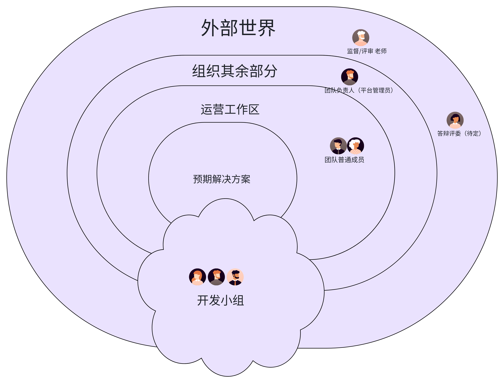

# 需求规格说明书（Software Requirements Specification）

---

- 项目名称：PodSpace

- 开发单位：三脚BUG队

- 文档版本：1\.1

- 编写日期：2026年10月31日

- 文档标准：GB/T 9385\-2008 《计算机软件需求规格说明规范》

---

# 一、引言

## 1\.1 编写目的

本文档旨在明确需求，明确功能和性能，方便用户和开发人员查看，达成共识，为之后的进一步开发软件打下基础。

## 1\.2 背景

随着互联网的发展，越来越多的软件接踵而至，其中不乏信息交流的软件，并且很多都是围绕协作打造，可是真正适合小型团队开发的协作软件是少之又少。 

对于一些小团队的人，一些基本的功能其实就够用了，而这个平台就提供了最基本的功能，聊天，文件传输，以及文档书写。

## 1\.3 预期读者

|预期读者|阅读建议|
|---|---|
|项目经理|希望通过这个文档，能基本了解产品预期功能，和用户需求，进而对项目进行系统的设计和管理。|
|开发人员|阅读完成之后能大概了解用户需求，并且据此设计前后端架构，完成预期功能，书写用户手册|
|测试人员|希望阅读之后，能书写对应功能的测试用例|
|用户|希望阅读之后，能了解项目预期功能，并且和开发人员协商需求的改动。|

## 1\.4 定义、缩写和术语

|术语|定义|
|---|---|
|US\-00X |US是user story的缩写，也就是用户故事，00X，其中X是数字，这个表示的是序号。|
|MEETING\-00X|会议功能的需求编号，MEETING\-001 为第一条。|

## 1\.5 参考资料

施工中\.\.\.

---

# 二、项目总体描述

## 2\.1 产品概述

### 2\.1\.1 项目领域 Domain

本项目所属领域为团队协同办公领域，面向小型工作团队开发一款轻量化项目协作平台，支持任务管理、文件共享\(文档同时共同编辑\)、组内沟通、线上会议等功能。

### 2\.1\.2 项目目标 Goals（目的\-益处\-衡量指标）

1. 实现一套轻量化的线上协作平台，支持小团队成员进行任务分配、进度查看、文件上传；

2. 简化小团队项目管理流程，降低团队内部消息同步、资料流转的成本。

目标陈述

1\.目的

使10人以内的小团队，在不稳定的网络条件下，用一个轻量工具完成一次完整的协作周期（分工、沟通、传文件、共同写文档），并把这一周期的全部过程资料留在同一个项目空间内\.

2\.益处

（1）**减少工具切换**。四类信息收敛在一个项目空间内，成员不必在聊天群、网盘与文档工具之间来回搬运，项目结束后也不需要重新拼装资料。

（2）**降低学习成本**。界面只围绕五件事组织，新成员无需培训即可使用，团队不必为工具本身付出额外时间。

（3）**内容不因网络抖动而丢失**。本地缓存与自动同步使成员在校园网不稳定时仍敢继续编辑，减少重复劳动。

（4）**进度可判断**。负责人随时能看到任务在谁手上、到哪一步，减少反复询问与催办，这是小团队最容易发生的内耗。

3\.衡量指标

本系统需要满足：小组仅依靠本平台即可完成小组作业协同，无需搭配其他协作工具；新用户独立完成新建项目、添加任务、上传文件、编辑文档的整套流程耗时不超过 5 分钟；网络波动时能够本地缓存编辑内容，网络恢复后自动同步，保障用户输入不丢失；项目资源相互隔离，非项目成员无法访问本组任务、聊天、文件和文档；系统基础功能稳定，不会因消息推送、文档协同产生崩溃；音视频会议与屏幕共享在局域网环境下稳定运行、不崩溃。

价值陈述

（1）功能价值陈述（解决业务效率问题）

> 功能价值：解决方案使业务过程成本更低、速度更快、可以完成之前难以开展的工作。
> 
> 

1. 作为课程小组组员，当我可以在同一个项目空间查看分配给自己的任务、接收小组消息、提交作业文件、参与多人文档编写，不用在多个软件来回切换，我就获得了价值。

2. 作为学生项目组长，当我可以快速拆分分配任务、查看全部成员任务进度，集中查阅所有项目资料，减少反复口头沟通确认的工作量，我就获得了价值。

（2）心理价值陈述（体验、感受层面的价值）

> 心理价值：带来便利、新颖、降低焦虑、操作简单好上手。
> 
> 

1. 作为课程小组组员，当工具操作简单，不需要学习大量无关功能；并且在校园网络不稳定时，我的编辑内容不会丢失，不用反复重新录入内容，我就获得了价值。

2. 作为学生项目组长，当项目全部任务、聊天记录、文件、文档统一归档保存，项目结束之后可以随时回看历史资料，不用担心资料分散丢失，我就获得了价值。

（3）附加价值陈述

> 附加价值： 解决方案在核心用途之外，让用户额外获得可积累的协作资产或正向完成感。
> 
> 

1. 作为课程小组组员，当项目结束后，我在项目空间里提交过的文件、参与过的文档编辑、完成的任务记录都自动留存，我可以随时回看自己在这个项目里做了什么、改过哪些内容，不用自己另外整理，我就获得了价值。

2. 作为学生项目组长，当项目结束后，系统自动保留完整的任务分工、文件版本和讨论记录，我可以在下一个课程项目中直接参考上次的分工方式和资料结构，不用从零开始规划，我就获得了价值。

### 2\.1\.3 问题空间调查范围

本次调查的**问题空间**，是小团队从**组建**到**归档**的**一次完整协作周期**，具体包括以下七段工作：

1. 组队与进入：负责人建立项目、成员通过邀请加入项目、确定各自在项目中的角色；

2. 任务分工与跟踪：负责人把工作拆成任务、指定负责人与截止时间，成员更新任务状态，负责人查看整体进度；

3. 组内沟通：成员围绕任务、资料与进度交换文字信息，并在消息中顺带传递文件；

4. 资料流转：上传作业与方案文件、下载查看、在项目空间内保留文件归属与时间；

5. 共同撰写：多人围绕同一份报告或策划文档同时编辑，编辑结果对其他成员可见；

6. 项目归档：项目结束后，任务、文件与文档仍保留在项目空间内，可以回看与复用。

7. 线上会议：项目成员在项目空间内随时发起音视频会议，按需共享屏幕、录制会议，并在本地留存会议记录。

### 2\.1\.4 范围边界

边界之内的工作必须研究与实现，边界之外的内容本期明确不做，以避免课程项目范围失控。

|**范围内**|**范围外**|
|---|---|
|10人以内小团队的项目组建立、邀请与成员管理|大型组织部门架构、多级审批、考勤与工时统计|
|任务的建立、指派、状态变更与进度查看|甘特图、关键路径、成本核算与资源负载分析|
|项目组内文字消息、会话历史与消息附带文件|消息已读回执与@提醒|
|项目组内线上会议（音视频、屏幕共享、会议录制）|会议预约与周期会议、会议纪要、会议号/链接、跨项目会议|
|20MB以内文件的上传、列表、下载与删除|大文件断点续传、云盘配额、对外分享链接与提取码|
|多人同时编辑的纯文本文档与简易版本回溯|富文本排版、表格公式、Office格式导入导出|
|项目内数据隔离与管理员、成员两级权限|跨组织单点登录、第三方账号体系与组织通讯录|
|PC端客户端（Windows、Linux）|移动端应用、小程序、浏览器网页版|

### 2\.1\.5 项目涉众 Stakeholders

涉众是需求的来源。判断标准是：凡是能够影响PodSpace的决策与实现，或者会被PodSpace的运行结果影响的个人与组织，均列入涉众，而不只局限于直接操作软件的人。

1. 团队普通成员：平台终端使用者，需要接受任务、上传资料、查看项目进度、参与沟通，是核心需求来源；

2. 团队负责人（平台管理员）：统筹项目、分配权限、管理项目组，可对平台功能提出管理侧需求；

3. 开发团队：项目实施团队、负责需求落地、系统开发、测试与文档；

4. 课程指导教师、答辩评委（待定）：项目评审决策者，决定项目验收标准。

由于我们（团队）其实本身也是一个团队，所以这个洋葱图对我们同样适用。

## 2\.2 需求工程分析

### 2\.2\.1 三个世界（组织世界、技术世界、物理世界）

现实世界

├── 组织世界

│   ├── 小型团队成员（如：课程小组成员、项目组长）

│   ├── 指导教师/课程评委

│   ├── 团队内部的分工、角色与职责

│   ├── 小组协作的规章制度/沟通习惯

│   └── 课程项目的交付要求与验收标准

│

├── 技术世界

│   ├── 待开发的 PodSpace 系统（前后端）

│   ├── 现有的操作系统（Windows 11、Linux）

│   ├── 数据库技术（用于持久化数据）

│   └── 校园网/不稳定网络环境

│

└── 物理世界

├── 用户的终端设备（Windows/Linux 电脑）

├── 服务器及网络通信设备（路由器、交换机等）

├── 用户输入/输出外设（键盘、鼠标、屏幕、麦克风）

└── 物理时钟与时间流逝（影响任务截止时间、弱网同步）

## 2\.3 用户特征与场景

|用户画像|行为特征|使用环境（场景）|
|---|---|---|
|课程小组成员（20岁，大学生） |时间碎片化，很多课程；接收开发/文档，上传作业才来哦，和队友同步问题，讨厌复杂冗余功能，优先看重简单好上手。|教室，使用卡得要死的校园网 宿舍，碎片化时间使用。|
|学生项目组长（21岁，大学生）|统筹小组课程项目，拆分任务，设置截止时间，需要快速汇材料和查看项目进度。|教室，使用卡得要死的校园网 宿舍，碎片化时间使用 路上，使用手机快速查看消息。|
|小型创业团队成员（25 岁）|项目节奏不稳定，经常临时调整任务；需要共享方案文档、同步客户反馈，随时沟通。|办公室 Wi‑Fi， 通勤路上 4G，电脑 \+ 手机随时切换。 |
|社团干事（19 岁，大学生） |负责社团活动筹备，任务短期、一次性；需要分工、共享策划案、收集报名资料，活动结束后归档项目。|校园 Wi‑Fi，手机使用频次很高。|
|自由职业搭档（29 岁）|2\~3 人小搭档接单做设计 / 文案，收入项目制；需要区分不同接单项目，共享源文件，核对交付节点|居家 Wi‑Fi、移动网络，在家办公为主。|
|工作室小组长（26 岁）|管理 3–5 人小工作室，分配外包订单任务，核对交付进度，汇总交付文件。|工作室内网，电脑为主。|

客户优先级排序

1. **优先级 1（核心客户）：课程小组成员、学生项目组长**

理由：本项目原始业务出发点就是解决高校课程小组协作痛点；调研主要样本来源于该群体，弱网、轻量化、简单易用等核心需求全部来自这部分用户；全部 Must‑have 核心功能优先保障该群体使用体验。

2. **优先级 2（次要客户）：社团干事** 

    理由：业务场景和课程小组高度重合，现有系统能力可以直接兼容；但是项目多为短期一次性活动，持续使用频次低于课程小组，不为该群体新增专属功能。

3. **优先级 3（延伸兼容客户）：小型创业团队成员、自由职业搭档、工作室小组长** 

理由：属于兼容适配人群，现有功能可以满足他们基础协作需求；不属于本项目首要服务对象，不会为该类用户额外扩展业务功能。

## 2\.4 操作环境

客户端运行环境：windows11;Linux;

## 2\.5 设计与实现约束

### 2\.5\.1 指定的技术、工具与语言

#### 编程语言

|**约束**|**原因**|
|---|---|
|C\+\+语言编写后端|这个是评审人的硬性要求|
|C\+\+\(ASIO库\)作为网络|便携性高,跨平台|
|QML书写前端|学习成本更低，并且效果更好|

### 2\.5\.2 指定的运行环境

|**约束**|**原因**|
|---|---|
|Windows11强兼容|Windows11是十分流行的系统|

### 2\.5\.3 开发规范与标准

|**约束**|**原因**|
|---|---|
|Conventional Commit|这样可以让git提交记录更加的清晰易懂，节约时间。|
|fork仓库进行开发，提交使用pr|这样能更好保证仓库安全性，并且能分担冲突解决任务。|

### 2\.5\.4 外部系统接口约束

### 2\.5\.5 数据格式约束

任何数据格式都是OK的，txt，xml，json用来数据持久化都是可以的，并且如果前期使用json后期使用xml都是可行的。

### 2\.5\.6

## 2\.6 假设与依赖关系

\(1）假设:

a\.使用者配备 Windows11 或 Linux 电脑，具备安装客户端的权限； 

b\.服务端部署环境可用，服务器不会无预期关停； 

c\.用户能够遵守平台使用规范，不上传违规内容。 

（2）依赖:

a\.依赖后端服务提供数据交互、消息转发、文档协同同步能力； 

b\.依赖数据库完成项目、任务、文档、文件信息的持久化存储； 

c\.依赖客户端本地存储能力，实现弱网场景下内容缓存。

---

# 三、具体需求

## 3\.0 功能列表

|模块|功能|优先级|
|---|---|---|
|会议|发起/加入/结束会议、音视频通话、屏幕共享、会议录制、本地会议记录|Must\-have|
|文档|待补|待定|
|聊天|待补|待定|
|任务|待补|待定|

## 3\.1 功能需求

> **功能需求**和**部分非功能需求**是书写在同一个地方的，非功能需求类似一个卡片一样贴附在上边，这是借鉴了用户故事实践的思想
> 
> 

### 3\.1\.1 文档功能

**功能概述**

提供团队文档的创建、编辑、管理和共享能力，方便团队成员共同维护项目资料。

**功能需求**

|**编号**|**需求名称**|**需求描述**|**约束（非功能需求）**|
|---|---|---|---|
|DOC\-001|创建文档|用户可以创建新的**团队（共享）**文档和**私密**文档。|创建时间 \< 0\.5s|
|DOC\-002|编辑文档|用户可以编辑已有文档的内容。|编辑文档能看到实时保存，并且能看到什么人正在查看。|
|DOC\-003|删除文档|用户可以删除自己有权限管理的文档。|无|
|DOC\-004|文档共享|用户可以将文档**共享**给团队内其他成员。|设置各种共享类型|
|DOC\-005|文档查看|用户可以查看**自己有权限访问**的文档。|无|

**相关约束**

- 文档内容需要支持 Markdown 格式。

这里的 Markdown 可以先作为待确认的产品约束，而不必现在就规定具体技术实现。

### 3\.1\.2 会议功能

**功能概述**

为项目成员提供项目组内的线上会议能力：成员可随时发起即时会议，其他项目成员在会议进行中随时加入，进行音视频通话与屏幕共享，并可将会议录制到本地、在本地留存会议记录。本期不做会议预约、周期会议与会议纪要，也不支持把会议号或链接分享给项目外成员。

**功能需求**

|编号|需求名称|需求描述|约束（非功能需求）|
|---|---|---|---|
|MEETING\-001|发起即时会议|项目成员（含普通组员）在所属项目内发起会议，创建后立即进入「进行中」，发起人自动成为主持人。|无预约、无周期会议；同一项目同一时刻仅允许一个「进行中」会议|
|MEETING\-002|加入会议|项目成员在会议「进行中」时可随时加入，包括中途加入。|仅限本项目成员；单场参会人数上限为项目成员上限 10 人|
|MEETING\-003|拒绝非成员加入|非项目成员无法进入任何会议，既没有会议入口，直接访问也会被拒绝。|安全：越权加入必须被拒绝，且不得进入会议房间|
|MEETING\-004|主持人管理参会者|主持人可对任一参会者执行静音、关闭摄像头、移除操作。|仅主持人可用|
|MEETING\-005|参会者主动退出|普通参会者可主动退出会议；不能结束会议，也不能管理其他参会者。|无|
|MEETING\-006|结束会议|主持人结束会议时全体参会者退出；主持人主动退出或断线时，会议自动结束。|会议状态变为「已结束」|
|MEETING\-007|音视频控制|参会者可独立开关麦克风与摄像头，二者可同时开启，并可切换音视频设备。|无|
|MEETING\-008|屏幕共享|屏幕共享作为画面源的模式切换，切换后其他参会者看到共享的画面内容。|仅主持人可发起共享；同一时刻只有一路画面源|
|MEETING\-009|会议录制|任一参会者均可在会议进行中自行开始、停止录制，录制文件保存在本地，可回放。|录制为个人行为，各自保存于本机；不做云端存储与对外分享|
|MEETING\-010|本地会议记录|会议结束后在本机记录会议名、开始时间、结束时间、时长、参会人与结束状态。|仅本机可见；不做会议纪要|
|MEETING\-011|入口消失与已结束提示|会议结束后项目内的会议入口消失；再次尝试进入时提示「会议已结束」。|无|

**业务规则**

1. 会议状态只有三种：进行中、已结束、已取消；不存在「待召开」状态。

2. 发起即开始，发起人自动成为主持人，无需审批。

3. 主持人主动退出或断线，会议立即结束，全体参会者一并退出。

4. 「结束」为正常收尾，「取消」为发起人在会议进行中主动终止；两者结果都是解散房间，仅记录的结束状态不同。

5. 同一项目同一时刻只允许存在一个「进行中」会议。

6. 单场会议参会人数上限与项目成员上限一致，为 10 人。

7. 普通参会者只能主动退出，无权结束会议、无权管理他人。

8. 非项目成员无法获得会议入口，直接访问同样被拒绝。

9. 会议结束后入口消失，再次进入提示「会议已结束」。

**相关约束**

- 音视频与屏幕共享同属一个画面源：同一时刻只显示摄像头画面或共享屏幕其中之一，切换即改变画面源。

- 录制文件与会议记录均保存在本机，不随项目同步，也不提供对外分享能力。

### 3\.1\.3 聊天功能

**功能概述**

为团队组成员提供必要的沟通能力，支持会话历史留存与相关文件传递（例如图片或者文档）以及语音聊天交流。

**功能需求**

|**编号**|**需求名称**|**需求描述**|**约束（非功能需求）**|
|---|---|---|---|
|CHAT\-001|发送文字消息 |成员可以在会话中发送文字消息，消息对其他成员可见|单条文本消息体 ≤ 150KB|
|CHAT\-002|发送图片消息|成员可发送图片，图片在会话中内嵌展示，支持点击查看大图。|支持jpg/png；单张\<=10MB|
|CHAT\-003|发送视频消息|成员可以发送视频文件，接收方可以下载之后播放|支持MP4；单个视频\<=100MB；不支持在线预览|
|CHAT\-004|发送文档消息|成员可以发送常见格式文档，接收方可以预览，也可以下载保存。|支持pdf/doc/docx/ppt/txt/zip/tar\.gz/xls;单个文件\<=50MB|
|CHAT\-005|接受查看会话历史|成员进入会话可以查看历史消息，可以通过选择时间查看历史消息|首次进入加载最近40条|
|CHAT\-006|接受消息|成员在线时可实时接收本项目新消息；不在线时消息留存，下次进入会话可见。|离线期间消息不丢失|
|CHAT\-007|文件下载|接收方可以下载消息中的文件，保存在本地之后可以随时查看不会丢失数据|下载的文件应该与发送方发送的文件一致|
|CHAT\-008|项目数据隔离|非同项目的成员不可以随便访问本组的相关聊天记录与文件|无|
|CHAT\-009|发送失败处理|聊天框中发送的数据没有发送成功时会给出明确提示，支持重发|重发不会产生重复消息|
|CHAT\-010|会话文件汇总|成员可以通过分类查看本项目会话中发送过的全部文件列表（图片/视频/文档分类），可以让成员快速方便地查找文件|相关分类陈列顺序按照时间倒序排列，可以先查找最近的文件|

**业务规则**

1\.会话类型：分为"项目会话"（组内公开，项目全体成员可见）与"私聊会话"（一对一）。

2\.权限：只有同一项目的会话成员可以进行上述活动，成员退出项目小组群之后就不再具备访问该项目下任何会话的权限。

**相关约束**

2\.文件大小具有相关限制，具体数据还可以进行调整。

3\.私聊内容只有彼此可见，即使是项目负责人，也不可以见，符合隐私约束。

### 3\.1\.4 任务功能

**功能概述**

**功能需求**

|**编号**|**需求名称**|**需求描述**|**约束（非功能需求）**|
|---|---|---|---|
|TASK\-001||||

**业务规则（如果有就填写，没有就删除这一项）**

**相关约束（如果有就填写，没有就删除这一项）**

## 3\.2 性能需求

|编号|性能项|指标|
|---|---|---|
|PERF\-001|会议并发|支持单场 10 人同时在线音视频|

> 说明：本期会议功能仅在局域网环境下测试与验收，不考核网络延迟、抖动与弱网可用性。
> 
> 

## 3\.3 外部接口需求

## 3\.4 系统属性

## 3\.5 数据需求

## 3\.6 逻辑结构说明

# 四、用例模型与典型场景

## 4\.1 用例图

## 4\.2 主要用例描述

## 4\.3 异常与扩展流程

# 五、界面原型与交互设计

## 5\.1 页面原型图

## 5\.2 页面流程

## 5\.3 交互逻辑说明

# 六、非功能需求

## 6\.1 安全与隐私保护

## 6\.2 兼容性与可移植性

## 6\.3 国际化/本地化

## 6\.4 数据备份与迁移策略

# 七、验收与测试标准

## 7\.1 功能验收标准

|编号|需求|验收标准|
|---|---|---|
|MEETING\-001|发起即时会议|Given 我是项目成员 When 我在项目内发起会议 Then 生成「进行中」会议，且我为主持人|
|MEETING\-002|加入会议|Given 会议处于进行中 When 项目成员加入 Then 进入会议房间，可中途加入|
|MEETING\-003|拒绝非成员加入|Given 我不是项目成员 When 我尝试加入该会议 Then 被拒绝，不进入房间|
|MEETING\-004|主持人管理参会者|Given 我是主持人 When 我对某参会者静音/关闭摄像头/移除 Then 操作生效，其他参会者不受影响|
|MEETING\-005|参会者主动退出|Given 我是普通参会者 When 我点击退出 Then 我离开会议，其他人不受影响|
|MEETING\-006|结束会议|Given 会议进行中 When 主持人结束会议或断开 Then 会议变「已结束」，全体参会者退出|
|MEETING\-007|音视频控制|Given 我在会议中 When 我关闭摄像头或麦克风 Then 他人看不到画面/听不到声音，另一路仍正常|
|MEETING\-008|屏幕共享|Given 我是主持人 When 我开启屏幕共享 Then 参会者看到共享画面，摄像头画面被替换|
|MEETING\-009|会议录制|Given 会议进行中 When 任一参会者开始录制 Then 录制进行，停止后本机生成可回放文件|
|MEETING\-010|本地会议记录|Given 会议已结束 When 我查看本机会议记录 Then 看到会议名、起止时间、时长、参会人与状态|
|MEETING\-011|入口消失与已结束提示|Given 会议已结束 When 我再次尝试进入 Then 提示「会议已结束」，不进入房间|

## 7\.2 性能测试指标

## 7\.3 安全测试

## 7\.4 容错与恢复测试

# 八、附录

## 8\.1 数据字典

## 8\.2 用户访谈与调研摘要

## 8\.3 术语表

|术语|释义|
|---|---|
|SRS|软件需求规格说明书|
|MEETING\-00X|会议功能需求编号，X 为序号，如 MEETING\-001。|

> （注：部分内容由豆包工作 AI 生成）
